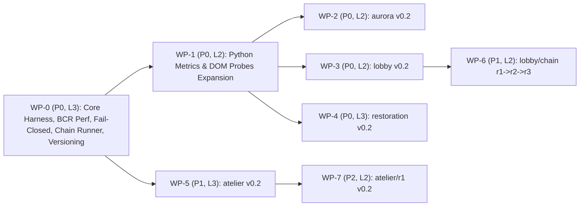

# MoL-Bench v0.2 — Complete Technical Design Specification

> **Status:** Design frozen for v0.2 implementation (`bench_version: "0.2.0"`, `spec_version: "0.2.0"`).  
> **Scope:** Design document only. v0.1 rooms (`rooms/`), hidden suites (`hidden/`), and pilot results (`results/`) remain untouched and gradeable side by side with v0.2 (`rooms-v2/`, `hidden-v2/`, `results-v2/`).

---

## 1. Diagnosis of v0.1 Pilot Saturation

The v0.1 pilot (24 graded runs across 18 model/effort configurations, 5 room tracks) confirmed that deterministic programmatic grading works end-to-end on a Windows laptop, but the leaderboard **cannot separate frontier models**: top models saturate near 9.5–10.0 across almost every room.

### 1.1 Quantitative Summary of v0.1 Pilot Results

| v0.1 Track | Runs | Observed Composite Range | Anchors / Notes | Primary Saturation Causes |
|---|---:|---|---|---|
| `lobby` (Build) | 18 | **8.63 – 9.97** (8 models tied at **9.97**) | Haiku max, Sonnet max, Opus high, Hydrogen high/xhigh, Neon med/high/xhigh all tied at `9.97` | **6 of 24 metrics returned `null` and silently dropped out of axis weights** (`theme.both_valid`, `a11y.reduced_motion_transition_ms`, `lh.lcp_ms`, `lh.cls`, `budget.transfer_kb`, `nav.transition_ms`); remaining CSS/typography bands passed trivially on first attempt; `tests.hidden` had weight `1` out of `17` computed craft weight so failing 1/7 hidden tests still yielded `craft = 9.9` and `composite = 9.97`. |
| `atelier` (Build) | 2 | **9.45 – 9.66** (Haiku high `9.66` > Sonnet high `9.45`) | Both scored **10.00 Craft** (`shape.iou_hidden` `0.989`–`0.995`) | `blueprint/dimensions.json` handed over every exact coordinate and radius of a regular hexagonal prism (no visual inference required); `vq.texel_density_cv` returned `null` when untextured and dropped out; Haiku beat Sonnet solely because `vq.detail_scale` had a hyper-narrow `[0.95, 1.00]` ideal band (`1.015` → `3.8`, `1.028` → `0.0`). |
| `aurora` (Build) | 0 runs (anchors calibrated) | `a8` = **9.93** | Static wallpaper attack once got free palette score (fixed via `G-alive`) | Single-layer fBM + static palette conversion cleared every craft/VQ band easily; `perf.frame_p95_norm_ms` was disabled by default (`--perf` off) and uncalibrated for battery vs. AC laptop power states; global `lum.mean` / `palette_fidelity` lacked spatial and physical-consistency constraints. |
| `restoration` (Build) | 2 | **8.35 – 9.32** (Haiku high `8.35`, Sonnet high `9.32`) | Both scored **10/10** on `bugs.fixed`, `tests.hidden`, `rootcause.accuracy` | The 4 planted bugs (`B1`–`B8`) were isolated, non-interacting 1–8 line textbook Three.js bugs with syntactically loud code (e.g. duplicate `convertLinearToSRGB()` calls, `if (width < height)` resize guard, deleted `.dispose()` loop with tracking arrays still present) and 1:1 bilingual giveaway complaints. Score loss came mostly from harness/band bugs (`diff.out_of_scope_files = 15–22` from workspace artifacts; `render.aliasing = 0.044` vs zero threshold `0.042` on the reference scene itself). |
| `lobby/r1` (Renovation) | 1 | **7.25** (Haiku high) | Spec/capture incomplete during pilot | `mask.element_ssim`, `layout.shift_px`, `lh.cls`, and `lh.lcp_ms` all returned `null` (start-state capture was added late); `text.line_length` and `space.grid4_frac` scored `0` largely due to `a5` baseline traits rather than bad edits. |
| `atelier/r1` (Renovation) | 1 | **0.87** (Haiku high) | Failed `G-reproducible` (geometry hash mismatch) | Request scores themselves were high (`AT-R2` 9.5, `AT-R3` 10.0, `AT-R4` 10.0 — Haiku even achieved 180° door open!), showing individual requests were too easy once `G-reproducible` is met. |
| `aurora/r1` (Renovation) | 0 | — | Never swept | Low incremental signal over `aurora` Build + `lobby` Renovation; consuming quota on 7 tracks made full sweeps unaffordable. |

### 1.2 Observed v0.1 Token Baseline (`1.0×` Reference)

From `results/*.json`, v0.1 `lobby` (Build) serves as our **`1.0×` quota baseline** per contestant run:

| Provider / CLI | v0.1 `lobby` Median Output Tokens | v0.1 `lobby` Median Total Tokens | Notes |
|---|---:|---:|---|
| Gemini / AGY (`Neon High`, `Hydrogen High`, `Flash High`) | **61k – 117k** (median ~**70k**) | **438k – 695k** (median ~**460k**) | Uncached/compact transcript accounting; fastest & most quota-available now. |
| Claude CLI (`Haiku`/`Sonnet`/`Opus` at `high`) | **54k – 95k** (median ~**65k**) | **5.6M – 8.8M** (median ~**6.0M**) | Dominated by `cache_read` (~95% of total); `max` effort exploded to `226k–248k` out / `26M–32M` total with zero score gain on saturated `lobby`. |
| Codex CLI (`GPT-6-Luna high`) | **54k** | **10.5M** | Unavailable for ~3 weeks. |

**Key Lesson:** Increasing task volume (more pages, more boilerplate) burns scarce model quota without discriminating better models. v0.2 must achieve difficulty through **depth, precision, coupled constraints, hidden-condition generalization, and genuine engineering trade-offs**, keeping per-run token cost near `1.0×–1.5×` v0.1 `lobby` (and `≤ 2.0×` for the 3-round renovation chain).

---

## 2. Calibration Targets, Anti-Gaming & Version Coexistence

### 2.1 v0.2 Calibration Targets (Hard Acceptance Criteria Before Freeze)

Every v0.2 track must satisfy all six calibration invariants before freeze:

| Target | v0.2 Requirement | Change vs. v0.1 |
|---|---|---|
| `null` (unchanged seed) | Composite **`∈ [0.0, 1.0]`** (fails ≥ 90% of hidden tests) | Tightened (was unstated; restoration null was `1.11`) |
| `a5` (deliberately mediocre anchor) | Composite **`∈ [4.5, 5.5]`** | Preserved |
| `a8` (expert reference anchor) | Composite **`∈ [7.5, 8.5]`** (even for `restoration` v0.2, where `a8` fixes all 6 bugs cleanly with strict diff/perf/aliasing/behavioral-test bands calibrated so expert reference ≈ `8.2`, reserving `8.5–10.0` for extraordinary optimization) | Tightened (`aurora` a8 was `9.93`, `restoration` a8 was `9.60`) |
| **Attack submissions** (≥ 3 per track) | **Every attack composite `< 3.0`** | Tightened from `≤ 4.0` / `≤ 5.0` |
| **Best current frontier model** (canary check) | Expected composite **`∈ [5.5, 7.0]`** | Down from `9.5–10.0` |
| **Tier discrimination** | `≥ 1.5` composite point spread between fast/small tier (e.g., `Flash`/`Haiku`) and frontier tier (`Neon High`/`Opus`/`Sonnet High`), and `≤ 2` models tied within `0.1` | New requirement |
| **Mutant sensitivity** | ≥ 5 single-defect mutants of `a8` per room; grader lowers composite on **5/5** (at least 4/5) | Preserved & tightened |
| **Determinism** | Two non-perf grades on different runs/days → **bit-identical** non-perf raw values; perf BCR within **±7%** across AC vs. battery | Added AC/battery invariant |

### 2.2 Fail-Closed Metric Scoring (No Silent Null-Drops)

In v0.1, `harness/src/score.mjs` skipped any metric whose `score === null` from the axis denominator (`wSum`). That silently erased 6 craft/VQ metrics in `lobby` and 1 in `atelier`.

**v0.2 Rule (`spec.fail_closed: true`, default for all `0.2.x` specs):**
1. Every metric declared in `spec.metrics` (and every sub-metric in `spec.requests[].metrics`) is **required** unless explicitly tagged `"optional_when": "<condition>"` (used *only* when a metric is structurally undefined, e.g. `no_textures` — and in v0.2 `atelier`, textures are mandatory so zero optional metrics remain!).
2. If a required metric evaluates to `null` or `undefined` during normal grading (`!noCapture && !noPython`), `scoreSubmission()` sets `score = 0`, appends a structured `missing_required_metric` warning, and **keeps its weight in `wSum`**.
3. If a metric fails to compute because of a **harness/environment instability** (e.g. unstable perf calibration, crashed Python subprocess), grading **aborts with non-zero exit code** (`ERR_HARNESS_UNSTABLE`) rather than publishing a corrupted score.
4. For `spec_version: "0.1.x"`, v0.1 behavior is preserved verbatim when `--version 1` is used so v0.1 results can still be re-graded reproducibly.

### 2.3 Side-by-Side Coexistence of v0.1 and v0.2

v0.1 rooms, hidden assets, and results are **never overwritten or moved**. v0.2 lives in parallel versioned directories:

```text
rooms/                  # v0.1 rooms — UNTOUCHED
hidden/                 # v0.1 hidden tests/refs/grade.json — UNTOUCHED
results/                # v0.1 graded results + v0.1 leaderboard.md — UNTOUCHED
harness/src/rooms/      # v0.1 room adapters — UNTOUCHED

rooms-v2/               # v0.2 rooms: aurora, lobby, restoration, atelier (+ renovation subdirs)
hidden-v2/              # v0.2 hidden tests, grade.json, refs, masks, blueprints, mutants
results-v2/             # v0.2 graded results (<run-id>.json), submissions/, leaderboard.md
harness/src/rooms-v2/   # v0.2 room adapters (aurora.mjs, lobby.mjs, restoration.mjs, atelier.mjs)
metrics3d/v2/           # v0.2 Blender 3D geometry/kinematics/clearance/UV/LOD evaluators
```

**CLI & Runner Resolution:**
- `bench grade <room> <dir> [--version 2]` (or `--spec rooms-v2/<room>/spec.json`): defaults to `--version 1` for backwards compatibility; `--version 2` (or `.bench-room` containing `{"room":"aurora","version":2}`) resolves specs from `rooms-v2/`, hidden assets from `hidden-v2/`, and adapters from `harness/src/rooms-v2/`.
- `node runner/prepare.mjs <room> --version 2 --run-id <id> [--renovation <r>]` writes `"bench_version": "0.2.0"` into `.run.json` and `.bench-room`, copies only `rooms-v2/<room>/seed` (never `hidden-v2/`), and sanitizes private keys identically to v0.1.
- `node runner/collect.mjs <id> --model "<label>"` reads `bench_version` from `.run.json` and automatically writes to `results-v2/` when `bench_version` starts with `0.2`, or `results/` when `0.1`.
- `node harness/src/leaderboard.mjs` generates:
  - `results/leaderboard.md` (v0.1 — preserved, regenerated only if `--version 1` or `--all`)
  - `results-v2/leaderboard.md` (v0.2)
  - `site/leaderboard/data.json` containing `{ versions: { "0.2": {...}, "0.1": {...} }, default_version: "0.2" }` and `site/leaderboard/index.html` with a top-level **Version Switcher (`v0.2` | `v0.1`)**.

---

## 3. Power-State Robust Performance & Efficiency Scoring

### 3.1 Power-State Robust Performance (Battery / AC / Travel Invariance)

Because grading executes on a Windows laptop that switches between AC, battery saver, and variable thermal states, **raw wall-clock milliseconds or absolute FPS are banned from v0.2 scoring**. Every performance metric uses either **(A) Bracketed Calibration Ratio (BCR)** or **(B) Deterministic Work Counts**.

#### A. Bracketed Calibration Ratio (BCR) Protocol

Used by `perf.frame_ratio` (`aurora`, `restoration`) and `perf.interaction_ratio` (`lobby`, `lobby/chain`):

1. **Interleaved Bracketing (`K = 5` rounds):** For each round `i ∈ {1..5}` inside the same browser launch session:
   - Run fixed calibration workload `C_pre,i` (2 s warm-up, 4 s measurement → metric `m_cal_pre,i`).
   - Run submission workload `S_i` (2 s warm-up, 4 s measurement → metric `m_sub,i`).
   - Run fixed calibration workload `C_post,i` (1 s warm-up, 4 s measurement → metric `m_cal_post,i`).
   - Compute round calibration baseline `C_bar,i = (m_cal_pre,i + m_cal_post,i) / 2`, round drift `d_i = |m_cal_post,i - m_cal_pre,i| / max(C_bar,i, 1e-6)`, and round ratio `r_i = m_sub,i / C_bar,i`.
2. **Calibration Workloads:**
   - **WebGL GPU calibration (`harness/src/capture/calibration/webgl_cal.html`):** Fixed 2-pass WebGL2 workload (1× full-viewport 12-octave FBO procedural pass + 1× composite pass with 4 texture taps + `gl.finish()`) at `1440x900` DPR 1, headed GPU Chromium (`--disable-gpu-vsync --disable-frame-rate-limit`). Metric = `p95` rAF frame delta (ms).
   - **DOM CPU-throttled calibration (`harness/src/capture/calibration/dom_cal.html`):** Fixed 48-card catalog DOM filtering + sorting + layout read (`getBoundingClientRect`) sequence under CDP `Emulation.setCPUThrottlingRate(4)` at `1440x900`. Metric = total scripted interaction duration (ms, summed across 12 filter/sort steps).
3. **Aggregation & Stability / Re-Grade Rule (`G-perf-cal`):**
   - A round `i` is **unstable** if `d_i > 0.12` (12% intra-round drift, e.g. AC plug/unplug or turbo-boost cliff).
   - The session calibration is **unstable** if `≥ 2` rounds are unstable **OR** `IQR(C_bar,1..5) / median(C_bar,1..5) > 0.15`.
   - **Re-grade rule:** On unstable calibration, wait `15 s` (cooldown) and re-run the perf block up to **2 retries**. If still unstable after 2 retries, set `perf_unstable: true` and **abort grading with exit code `75` (`EX_TEMPFAIL`)** so the runner schedules a re-grade instead of recording a noisy score.
   - Final raw value = `median(r_i over stable rounds)`.
   - **Stated tolerance:** **`±7%`** across AC vs. battery power plans on the same laptop (validated by WP-0 acceptance tests).

#### B. Deterministic Work Counts (Zero Power-State Variance)

Used alongside BCR so algorithmic efficiency is rewarded even when `--no-perf` is passed during local development:

| Metric ID | Definition | Variance |
|---|---|---|
| `budget.shader_alu_est` | Static GLSL fragment shader complexity score computed by `molmetrics/budget_glsl.py`: parses all active fragment shaders (captured via hooked `gl.shaderSource` + `gl.linkProgram` in `host.js`), expands constant-bound `for` loops (unbounded/uniform-bound loops count as worst-case `32` iterations unless provably capped), sums weighted ops: `1` per basic ALU op, `4` per transcendental (`sin/cos/exp/pow/log/sqrt`), `8` per texture fetch (`texture*`), `2` per branch, summed across all fragment shaders executed in a frame. | **0% (bit-exact)** |
| `budget.render_passes` | Count of distinct framebuffer bindings (`gl.bindFramebuffer`) + draw batches per `renderFrame()`, captured via `host.js` WebGL2 instrumentation (cannot be spoofed by `stats()`). | **0% (bit-exact)** |
| `budget.draw_calls` | Actual `gl.drawArrays*` / `gl.drawElements*` calls intercepted by `host.js` during `renderFrame()` (replaces trusting self-reported `stats().drawCalls`!). | **0% (bit-exact)** |
| `budget.transfer_kb` | Total `encodedDataLength / 1024` across all CDP `Network.loadingFinished` responses on initial page load (gzip-served local server). | **0% (bit-exact)** |
| `budget.dom_nodes` | Total `document.querySelectorAll('*').length` after rendering the 48-room stress variant. | **0% (bit-exact)** |
| `perf.cls` | Cumulative Layout Shift measured deterministically via injected `PerformanceObserver({ type: 'layout-shift', buffered: true })` during initial load + font load + scripted filter/drawer sequence (replaces flaky Lighthouse `lh.cls`). | **0% (bit-exact)** |

### 3.2 Efficiency Axis (`active_min` + Tokens)

> **Integration Note (WP-0):** A parallel worker already implements `active_min` (sum of inter-event gaps in agent logs/transcripts, each gap capped at `5.0 min`) and awake-time limit enforcement in `runner/hc/autopilot.sh`, `runner/collect.mjs`, `runner/tokens.mjs`, and `harness/src/leaderboard.mjs`. **WP-0 builds directly on that branch and does NOT re-implement active-time collection.**

#### Schema in `results-v2/<run-id>.json`

```json
"efficiency": {
  "active_min": 18.4,
  "wall_min": 142.7,
  "time_limit_active_min": 45,
  "timed_out_active": false,
  "tokens": {
    "source": "agy|claude|codex|orchestra",
    "input": 380000,
    "output": 64200,
    "reasoning": 18400,
    "cache_read": 0,
    "cache_write": 0,
    "total": 462600,
    "weighted_k": 793.0
  },
  "efficiency_score": 7.8
}
```

#### Scoring Rules for Efficiency

1. **Composite Separation (Preserved):** `efficiency_score` is **never blended into `composite`**. Quality (`composite`) and cost (`efficiency_score`) remain orthogonal axes so slow, thorough models aren't artificially penalized in quality rankings, while fast, frugal models shine in efficiency and Pareto views.
2. **Cross-Provider Weighted Token Count (`weighted_k`):** Because Claude transcripts report huge `cache_read` totals (`5M–32M`) while Gemini/AGY reports compact totals (`0.4M–1.4M`), raw `total` tokens are non-comparable across providers. Define:
   $$\text{weighted\_tokens} = 1.0 \cdot \text{input} + 5.0 \cdot (\text{output} + \text{reasoning}) + 0.1 \cdot \text{cache\_read} + 1.25 \cdot \text{cache\_write}$$
   $$\text{weighted\_k} = \text{weighted\_tokens} / 1000$$
   *(Matches standard API cost ratios ~1:5:0.1:1.25; on v0.1 `lobby`, Claude Sonnet high ≈ `890k`, Gemini Neon high ≈ `680k` — directly comparable!)*
3. **Efficiency Score (`[0, 10]`, reported separately):**
   - `eff_tokens = scoreLower(weighted_k, full = track.eff_tok_full_k, zero = track.eff_tok_zero_k)`
   - `eff_time   = scoreLower(active_min, full = 0.35 * time_limit_active_min, zero = time_limit_active_min)`
   - `efficiency_score = 0.65 * eff_tokens + 0.35 * eff_time`
   - Raw `wall_min` is retained as diagnostic metadata only, never used in `efficiency_score` or timeout checks.
4. **Leaderboard Tie-Breaking & Pareto Badge:**
   - Primary sort: `composite` descending (rounded to `0.01` internally, displayed to `0.1`).
   - Tie-breaker when `|composite_A - composite_B| < 0.05`: `reliability` desc → `efficiency_score` desc → `weighted_k` asc.
   - Leaderboard displays `Composite`, `Efficiency (0–10)`, `Active (min)`, `Out+Reas tok`, `Weighted tok`, and highlights **Pareto-frontier models** (no other model has both higher `composite` and lower `weighted_k`).
5. **Active-Time Limit Enforcement:**
   - Timeout is triggered **solely** when `active_min > spec.time_limit_active_min`. Laptop sleep/suspend gaps (`> 5 min` gap between activity events) are capped and never trigger false timeouts.

---

## 4. MoL-Bench v0.2 Room Suite (6 Tracks Total)

### 4.1 Disposition of v0.1 Tracks

| Track | v0.1 Status | v0.2 Disposition | Priority | Est. Token Cost vs. v0.1 `lobby` (`1.0×`) |
|---|---|---|---|---:|
| `aurora` (Build) | Saturated (`a8 = 9.93`) | **Overhauled** (`rooms-v2/aurora`) | **P0** | **`1.2×`** |
| `lobby` (Build) | Saturated (8 models at `9.97`) | **Overhauled** (`rooms-v2/lobby`) | **P0** | **`1.3×`** |
| `restoration` (Build) | Saturated (`8.35–9.32`, 10/10 bugs) | **Overhauled** (`rooms-v2/restoration`) | **P0** | **`1.4×`** |
| `atelier` (Build) | Saturated (`9.45–9.66`, 10/10 craft) | **Overhauled** (`rooms-v2/atelier`) | **P1** | **`1.5×`** |
| `lobby/chain` (`r1→r2→r3`) | *Replaces single-shot `lobby/r1`* | **New Chained Renovation** (`rooms-v2/lobby/renovation/chain`) | **P1** | **`1.9×`** (sum of 3 capped rounds) |
| `atelier/r1` (Renovation) | Broken gate (`0.87`) / easy reqs | **Overhauled** (`rooms-v2/atelier/renovation/r1`) | **P2** (optional) | **`1.1×`** |
| `aurora/r1` (Renovation) | Never swept | **Retired** (saves quota; aesthetic/perf tension moved into `aurora` v0.2) | — | — |
| `lobby/r1` (single-shot) | Replaced | **Retired** (subsumed by `lobby/chain`) | — | — |

**Total Suite Cost per Contestant:** P0-only (3 tracks) = **`3.9×`**; P0+P1 (5 tracks) = **`7.3×`**; Full 6 tracks = **`8.4×`** v0.1 `lobby`.

---

### 4.2 Track 1: `aurora` v0.2 (Build — P0)
**"Boreal Fjord — Real-Time Shader Under Quality-vs-Performance Trade-Offs"**

- **What is measured:** Multi-layered WebGL2 fragment shader craft, physical light/reflection coupling, spatial-temporal visual hygiene, generalization across extreme unseen viewports and OKLCH palettes, and algorithmic optimization under a strict power-state-normalized GPU budget.
- **Prompt outline:**
  - Build a full-viewport WebGL2 real-time aurora borealis over a dark mountain ridge **and a calm alpine fjord lake** in `room/index.html` (`≤ 2` draw calls, `0` external assets, `0` network requests).
  - Visual requirements:
    1. Multi-curtain aurora driven dynamically by `params.palette` (3 OKLCH colors) with vertical ray structure and distinct spatial color bands (low altitude vs. high altitude curtain separation).
    2. Star field with smooth sub-10 Hz twinkle and aspect-correct circular stars across any resize.
    3. Procedural horizon silhouette occupying the middle-lower band (`y ∈ [0.58H, 0.72H]` parameterized by `params.horizonY`), **with aurora rim-lighting on the mountain ridge** that responds dynamically to the aurora brightness directly overhead.
    4. **Alpine lake below the horizon (`y > horizon`)** showing a physically consistent, softly rippled, Fresnel-attenuated inverted reflection of the aurora and brightest stars.
    5. Smooth pointer parallax + subtle vertical tilt (`pointer = [x, y]`), spatial dithering (zero 8-bit banding), `prefers-reduced-motion: reduce` (slow/frozen gracefully without blanking), and `prefers-contrast: more` (boosted ridge/sky separation).
  - Deliverables: `room/index.html`, `report.json`. Active-time limit: **45 min**.
- **Seed / start state:** Minimal WebGL2 shell (`rooms-v2/aurora/seed/`) implementing `BenchRoom` v1 boilerplate + uniform plumbing for `params`, rendering a flat dark canvas (fails `G-alive` and all visual metrics).
- **Hidden conditions (`hidden-v2/aurora/grade.json`):**
  - **4 unseen seeds** with extreme perturbed OKLCH palettes (including narrow-hue high-chroma green/cyan `[0.76, 0.21, 148]` + low-L violet `[0.46, 0.18, 295]`, warm solar-storm crimson/amber `[0.68, 0.19, 25]`), unseen `horizonY ∈ [0.54, 0.70]`, `waterRoughness ∈ [0.2, 0.8]`, `starDensity ∈ {sparse, normal, dense}`, `motionScale ∈ [0.6, 1.5]`.
  - **Unseen viewports:** public `["1440x900", "768x1024", "360x780"]`; hidden adds **ultrawide `2560x640`** and **narrow `320x720`** (breaks hardcoded aspect/UV math!).
  - **Unseen timestamps** `[333, 1850, 4720, 8110, 15400, 29300]` ms (catches periodic glitches and float precision decay at large `t`).
  - **Unseen pointer trajectory** (`[0.1, 0.2] → [0.9, 0.85]`) + resize stress `2560x640 → 320x720 → 1440x900` at DPR 2.
- **Gates:** `G-load` (≤ 12s SwiftShader), `G-console`, `G-contract`, `G-determinism`, `G-live` (FLIP ≤ 0.015), `G-alive` (median `time.motion > 0.0008`), `G-offline`, `G-raster` (0 KB — pure shader!), `G-report`, `G-perf-cal` (when perf enabled).
- **Composite weights:** `craft: 0.45`, `visual_quality: 0.40`, `reliability: 0.15`.
- **Metrics, Weights, Bands & Algorithm Deltas vs. `docs/METRICS.md`:**

| Metric ID | Axis | Wt | Score Type & Bands | `at` / `agg` | Algorithm / Delta vs. `docs/METRICS.md` |
|---|---|---:|---|---|---|
| `color.palette_fidelity` | craft | 2 | `higher` full `0.88`, zero `0.50` | all vps, all ts / `median` | Same as v0.1, computed **strictly in sky region** (`y < horizonY(x)`) with tighter ΔE_OK `< 0.08` (was `0.10`). |
| `color.palette_band_sep` | craft | 3 | `higher` full `0.75`, zero `0.25` | `1440x900`, all ts / `median` | **NEW (`molmetrics/spatial.py`):** Checks all 3 palette colors appear with ≥ 6% chromatic pixel share AND vertical spatial stratification: compute mean normalized altitude `y_k` of chromatic pixels assigned to palette color `k`; require pairwise altitude separation `std(y_0,y_1,y_2) ≥ 0.045` (kills homogeneous noise mixing all colors uniformly). |
| `scene.reflection_coherence` | craft | 3 | `higher` full `0.62`, zero `0.20` | `1440x900`, `t in [1850, 8110]` / `median` | **NEW (`molmetrics/reflection.py`):** Detect per-column horizon `h(x)` (from `scene.silhouette` ridge); mirror sky strip `[h(x)-d, h(x)]` vertically onto lake strip `[h(x), h(x)+d]` (`d = min(h, H-h)`). Compute normalized cross-correlation (NCC) of blurred (`σ=6`) OKLab `L,a,b` between mirrored sky and lake, AND require mean lake lightness `< 0.85 ×` mean sky lightness (Fresnel attenuation). Value = `NCC * fresnel_ok`. |
| `scene.water_ripple` | craft | 2 | `range` ideal `[0.015, 0.12]`, zero `[0.0, 0.30]` | `1440x900`, `t=4720` / `median` | **NEW (`molmetrics/reflection.py`):** High-pass horizontal-vs-vertical gradient anisotropy in the lake region: `(mean |∂L/∂y| - mean |∂L/∂x|) / (mean |∂L/∂y| + mean |∂L/∂x| + 1e-5)` scaled by temporal lake-minus-mirrored-sky FLIP. Rejects both flat mirror copies (`0`) and chaotic TV static (`> 0.30`). |
| `scene.terrain_lighting` | craft | 2 | `higher` full `0.55`, zero `0.10` | `1440x900`, all ts / `median` | **NEW (`molmetrics/reflection.py`):** Sample a 6 px ridge-crest band just below `h(x)` and a 40 px aurora band directly above `h(x)` across 32 horizontal columns × all timestamps. Compute Pearson correlation `r` between column aurora luminance and ridge-crest rim luminance, provided ridge interior stays dark (`L < 0.07`). Catches flat black cutouts with zero lighting coupling. |
| `scene.star_count` | craft | 1 | `range` ideal `[90, 500]`, zero `[10, 2000]` × `starDensity` | `1440x900`, `t=333` | Same as v0.1, restricted strictly to sky (`y < h(x) - 8`). |
| `scene.star_roundness` | craft | 2 | `range` ideal `[0.88, 1.14]`, zero `[0.65, 1.60]` | `after resize 2560x640 -> 320x720 -> 1440x900`, DPR 2 / `worst` | Tighter band than v0.1 (`[0.8, 1.25]`) + extreme ultrawide/narrow resize sequence. |
| `interact.pointer_response` | craft | 1 | `range` ideal `[0.015, 0.075]`, zero `[0.002, 0.22]` | `1440x900`, `t=4720` | Delta: evaluates both horizontal AND vertical pointer shift (`[0.1,0.2]` vs `[0.9,0.85]`). |
| `a11y.reduced_motion` | craft | 2 | `lower` full `0.002`, zero `0.012` | `1440x900` | Paired with `reduced_motion.not_blank` (if blank, score forced to `0`). |
| `perf.frame_ratio` | craft | 4 | `lower` full `0.95`, zero `2.20` | `1440x900` GPU BCR | **NEW (BCR §3.1A):** Median ratio `p95(sub) / p95(webgl_cal)` across 5 bracketed rounds. Forces real shader efficiency (volumetric aurora + reflection must run faster than the 12-octave FBO calibration reference). |
| `budget.shader_alu_est` | craft | 2 | `lower` full `650`, zero `2400` | static GLSL capture | **NEW (`molmetrics/budget_glsl.py`):** Deterministic weighted op-count across active fragment shaders (§3.1B). Prevents brute-force 64-step raymarchers even on fast GPUs. |
| `budget.draw_calls` | craft | 1 | `lower` full `2`, zero `12` | `1440x900` | Hooked WebGL2 call count (not self-reported). |
| `tests.hidden` | craft | 2 | `ratio` | hidden tests | Includes `prefers-contrast: more`, seed round-trip `A→B→A`, `resume()` continuity, ultrawide/narrow resize, `horizonY` adherence. |
| `time.motion` | visual_quality | 2 | `range` ideal `[0.0025, 0.014]`, zero `[0.0008, 0.050]` × `motionScale` | `1440x900` | Tightened vs. v0.1; verifies `motionScale` actually scales speed across seeds (`motion_scale_corr` checked in hidden tests). |
| `time.flicker` | visual_quality | 3 | `lower` full `0.10`, zero `0.35` | `1440x900`, `t0=2500` | Tightened vs. v0.1 (`0.15 / 0.50`). |
| `render.banding` | visual_quality | 3 | `lower` full `0.001`, zero `0.009` | all vps, all ts / `worst` | Tightened + aggregated by **`worst`** across viewports (catches dithering broken at ultrawide/narrow aspect ratios). |
| `render.aliasing` | visual_quality | 2 | `lower` full `0.012`, zero `0.042` | `1440x900`, `2560x640`, `t=4720` / `worst` | Tightened + checks ridge & lake horizon aliasing. |
| `lum.dynamic_range` | visual_quality | 2 | `range` ideal `[0.10, 0.24]` (mean L) + highlight `[0.004, 0.05]`, zero outside | all vps, all ts / `median` | Combined sky luminance & highlight balance (replaces separate easy `lum.mean`/`lum.highlight_frac`). |
| `report.honesty` / `autonomy` | reliability | 6 / 4 | `higher` `10 / 0` | — | Unchanged (`docs/SCORING.md §5`). |

- **Anchors:** `null` (`0.0`, fails `G-alive`), `a5` (`4.9` — basic single-pass aurora + crude unrippled mirror + no rim lighting + mediocre ALU ~1300), `a8` (`8.1` — optimized 2-pass/analytic multi-curtain aurora, rippled Fresnel lake reflection, dynamic ridge rim light, blue-noise/IGN dithering, `perf.frame_ratio ≈ 0.88`, `ALU ≈ 580`).
- **Attacks (all `< 3.0`):**
  1. `palette-mirror-fake`: static/slowly-oscillating palette stripes mirrored horizontally → fails `scene.water_ripple`, `scene.terrain_lighting`, `scene.star_count`, `tests.hidden` (`≤ 2.4`).
  2. `bruteforce-64step`: heavy 64-step volumetric raymarcher with high visual quality but `perf.frame_ratio > 2.5` and `ALU > 3000` → perf + ALU + banding/aliasing drag craft down; also misses `terrain_lighting` (`≤ 2.8` with tuned attack missing lighting/water).
  3. `flat-black-stars`: near-black sky with twinkling stars and solid black lake → fails `color.palette_fidelity`, `palette_band_sep`, `reflection_coherence`, `terrain_lighting` (`≤ 2.2`).
- **Expected failure modes of strong models (landing at `5.5–7.0`):** Hardcoding `horizonY` instead of reading `params.horizonY`; ignoring `2560x640` ultrawide aspect scaling (stretching stars or clipping reflection); writing a slow 32+ step loop that tanks `perf.frame_ratio` & `budget.shader_alu_est`; forgetting Fresnel attenuation or ripple anisotropy in the lake; omitting temporal coupling between overhead aurora and mountain ridge rim light.

---

### 4.3 Track 2: `lobby` v0.2 (Build — P0)
**"Museum Catalog & Entrance — Interactive Editorial App Under Hidden Edge Conditions"**

- **What is measured:** Production-grade responsive editorial UI, trilingual typography (`ko`/`en`/`ja`), interactive client-side state (search, multi-filter, sort, accessible detail drawer, URL state sync), strict accessibility (WCAG + APCA contrast across `light`, `dark`, and `prefers-contrast: more`), zero layout overlap, and 4×-CPU-throttled interaction performance.
- **Prompt outline:**
  - Build the Museum of Light interactive catalog at `lobby/index.html` consuming `window.__benchHost.params.rooms` (each room has `id`, `route`, `title_ko`, `title_en`, `title_ja`, `summary_ko`, `summary_en`, `summary_ja`, `category` ∈ `{light, sound, kinetic, archive}`, `duration_min`, `tags[]`, `accent_oklch`, `status` ∈ `{open, coming_soon}`).
  - Required features & `[data-bench]` landmarks: `header`, `hero-title`, `search-input`, `filter-bar` (category chips), `sort-select` (`default|title|duration`), `lang-toggle` (`ko|en|ja`), `theme-toggle` (`light|dark`), `room-card` (one per matching room), `body`, `empty-state`, `detail-drawer` (modal/drawer previewing room metadata + "Enter Room" CTA before navigating to `#/room/<id>`), `footer`.
  - Interactive invariants:
    1. Filter, search, sort, language, and open room sync bidirectionally with URL hash/query (`#/?q=...&cat=...&sort=...&lang=...`) and survive browser Back/Forward + reload.
    2. Opening `detail-drawer` traps Tab focus inside the drawer, closes on `Escape` or backdrop click, and restores focus to the exact triggering card.
    3. `coming_soon` cards may open a non-navigable preview or show disabled status, but `state().route` must never become a `coming_soon` id.
    4. Smooth, deterministic navigation/drawer transitions (`150–450 ms`), collapsing to `≤ 50 ms` under `prefers-reduced-motion: reduce`.
  - No external CDN/fonts; zero frameworks beyond seed. Deliverables: `lobby/index.html` (+ local assets in `lobby/`), `report.json`. Active-time limit: **50 min**.
- **Seed / start state:** Bare HTML skeleton (`rooms-v2/lobby/seed/`) with `BenchRoom` v1 stub and offline font subset (Pretendard-subset / Noto Sans subset optional, or clean system stack; `G-fonts-local` enforced).
- **Hidden conditions (`hidden-v2/lobby/grade.json`):**
  - **Unseen viewports:** public `["360x780", "768x1024", "1440x900"]`; hidden adds **`320x568`** (SE mobile), **`1920x1080`**, and **`1440x900` with `200%` text zoom** (`html { font-size: 32px }` injected by harness to test `rem`-based reflow!).
  - **Unseen locales & extreme data variants:** `ja` (Japanese — tests CJK line-breaking & 18–40 char line lengths), `0` rooms, `1` room, **`48` rooms** (perf + scroll stress), **unspaced 52-char Latin URL/slug title**, **42-syllable Hangul title**, mixed CJK+Latin+numbers summary, and `prefers-contrast: more` mode.
  - **Unseen scripted interaction flows (`flow` probe):** 6-step deterministic Playwright user script (search query → category filter → sort by duration → keyboard Tab to 3rd card → Enter opens drawer → Tab wraps inside drawer → Esc closes & verifies `document.activeElement` is the 3rd card → click Enter Room → verify route → browser Back restores exact filter/sort/scroll!).
- **Gates:** `G-load` (≤ 6s), `G-console`, `G-contract`, `G-determinism`, `G-offline`, `G-raster` (≤ 32 KB/file, 128 KB total), `G-fonts-local`, `G-report`, `G-perf-cal`.
- **Composite weights:** `craft: 0.45`, `visual_quality: 0.40`, `reliability: 0.15`.
- **Metrics (zero null-drops; all 6 v0.1 broken metrics fixed & hardened):**

| Metric ID | Axis | Wt | Score Type & Bands | `at` / `agg` | Algorithm / Delta vs. `docs/METRICS.md` |
|---|---|---:|---|---|---|
| `data.rooms_rendered` | craft | 2 | `ratio` | all vps, variants=`normal\|many_48` / `worst` | Must render all 48 rooms cleanly. |
| `data.edge_cases` | craft | 2 | `ratio` | `320x568`, `1440x900@zoom200` | Combines `empty_state`, 42-syllable Hangul title, 52-char unspaced Latin token (no overflow/clip), `ja` rendering, `1-room` max-width cap. |
| `interact.scripted_flow` | craft | 4 | `ratio` | `1440x900`, `360x780` / `worst` | **NEW (`probes/flow.js`):** Runs the 10-checkpoint hidden Playwright user script (filter + sort + URL hash sync + drawer focus trap + Esc focus return + Back scroll restoration + reload persistence). |
| `layout.overflow_count` | craft | 3 | `lower` full `0`, zero `3` | all vps (incl. `320x568`, `zoom200`), both schemes / `worst` | Tightened zero threshold (`5 → 3`). |
| `layout.overlap_count` | craft | 3 | `lower` full `0`, zero `4` | all vps (incl. `320x568`, `zoom200`), variants=`normal\|lang_ja` / `worst` | **NEW (`probes/overlap.js`):** Pairwise AABB intersection check among visible sibling block/interactive elements (ignoring intentional `position: fixed/sticky` overlays when closed, or overlapping > 2 px²). Catches broken CSS grids under 200% zoom and small viewports. |
| `text.clipped_count` | craft | 2 | `lower` full `0`, zero `3` | all vps, variants=`normal\|lang_en\|lang_ja` / `worst` | Tightened (`5 → 3`). |
| `a11y.axe_violations` | craft | 2 | `lower` full `0`, zero `5` | all vps, `light\|dark\|high_contrast` | Tightened (`10 → 5`) + includes `prefers-contrast: more`. |
| `a11y.apca_contrast` | craft | 2 | `higher` full `1.0`, zero `0.70` | `1440x900`, `light\|dark\|high_contrast` / `worst` | **NEW (`probes/contrast_apca.js`):** Computes APCA `|Lc|` for every visible text node against its composited background pixel (from screenshot bbox sampling, catching gradient/overlay contrast failures that `axe` misses!). Threshold: `|Lc| ≥ 60` for body (`≥ 75` under `prefers-contrast: more`), `≥ 45` for large headings. Value = passing fraction. |
| `a11y.keyboard_focus` | craft | 2 | `ratio` | `360x780`, `1440x900` / `worst` | Combines `keyboard_reach` + `focus_visible` (focus ring contrast ≥ 3:1 in both themes). |
| `theme.tri_valid` | craft | 1 | `pass` | `1440x900` | **Fixed (was null in v0.1!):** Verifies `light`, `dark`, and `prefers-contrast: more` produce 3 distinct pixel SHA-256 hashes AND 0 contrast failures. |
| `a11y.reduced_motion_transition_ms` | craft | 1 | `lower` full `50`, zero `200` | `1440x900`, `reduced_motion` | **Fixed (was null in v0.1!):** Wired via CDP virtual-time frame stepper on drawer open + room route transition. |
| `perf.interaction_ratio` | craft | 3 | `lower` full `1.00`, zero `2.50` | `1440x900`, `48 rooms`, 4× CPU throttle | **NEW (BCR §3.1A):** Median ratio of scripted 12-step filter/sort/search duration vs. `dom_cal.html` under 4× CPU throttle. Catches O(N²) DOM thrashing and unbatched reflows. |
| `perf.cls` | craft | 2 | `lower` full `0.01`, zero `0.15` | `1440x900`, `320x568` / `worst` | **Fixed (replaces null `lh.cls`):** Deterministic `PerformanceObserver` CLS across load + filter + drawer open. |
| `budget.transfer_kb` | craft | 1 | `lower` full `120`, zero `500` | `1440x900` | **Fixed (was null in v0.1!):** Actual CDP `encodedDataLength` sum. |
| `tests.hidden` | craft | 2 | `ratio` | hidden tests | Heading hierarchy, `coming_soon` non-navigation, `html[lang]` sync across `ko/en/ja`, ARIA dialog roles. |
| `text.hangul_midword_breaks` | visual_quality | 2 | `lower` full `0`, zero `5` | all vps / `worst` | Tightened (`10 → 5`). |
| `text.line_length` | visual_quality | 2 | `range` `ko:[22,42]` / `ja:[20,38]` / `en:[48,80]` | `1440x900`, `768x1024`, `lang_ko\|lang_en\|lang_ja` | Adds Japanese band and tightens English/Korean ranges. |
| `text.line_height` | visual_quality | 1 | `range` `cjk:[1.55,1.85]` / `latin:[1.4,1.7]` | all vps | Tightened. |
| `type.hierarchy` | visual_quality | 2 | `higher` full `1.0`, zero `0.4` | `1440x900` | Combines `type.size_steps ∈ [4,6]` + `type.scale_ratio_min ≥ 1.15` + H1/body ratio `≥ 1.8`. |
| `space.grid4_frac` | visual_quality | 2 | `higher` full `0.94`, zero `0.65` | all vps / `worst` | Tightened (`0.90/0.50 → 0.94/0.65`) and `worst` viewport agg. |
| `align.column_count` | visual_quality | 1 | `lower` full `6`, zero `14` | `1440x900` | Tightened (`8/20 → 6/14`). |
| `nav.transition_ms` | visual_quality | 2 | `range` ideal `[160, 420]`, zero `[0, 1000]` | `1440x900` | **Fixed (was null in v0.1!):** Wired via CDP virtual time on drawer open & route switch. |
| `visual.congestion` | visual_quality | 2 | `range` calibrated `[a8-12%, a8+12%]`, zero `±35%` | `1440x900`, `light\|dark` / `worst` | Evaluated in BOTH light and dark schemes. |
| `report.honesty` / `autonomy` | reliability | 6 / 4 | `higher` `10 / 0` | — | Unchanged. |

- **Anchors:** `null` (`0.6`), `a5` (`5.1` — works on desktop `ko`, lacks `ja` typography polish, drops focus return on Esc, minor overlap at `zoom200`, `4×` CPU reflow ratio `~1.8`), `a8` (`8.2` — clean semantic catalog, full URL/focus-trap state, APCA-compliant tri-theme, zero overlap at `320px` and `200%` zoom, `interaction_ratio ≈ 0.85`).
- **Attacks (all `< 3.0`):**
  1. `plain-list`: unstyled HTML list with native `<details>` → fails `nav.transition_ms`, `type.hierarchy`, `visual.congestion`, `interact.scripted_flow`, `theme.tri_valid` (`≤ 2.6`).
  2. `static-no-state`: visually polished page with hardcoded cards & non-functional filter/drawer → fails `interact.scripted_flow`, `data.edge_cases`, `tests.hidden` + completeness multiplier `< 0.5` (`≤ 2.1`).
  3. `dom-bloat-redraw`: recreates entire DOM + layout thrashing per keystroke with `px`-locked fonts that overlap at `200%` zoom → fails `layout.overlap_count`, `perf.interaction_ratio`, `perf.cls` (`≤ 2.7`).
- **Expected failure modes of strong models (`5.5–7.0`):** Breaking layout under `200%` root font zoom (`px` heights/fixed widths causing `layout.overlap_count > 0`); failing focus trap or focus restoration on `Escape` inside `detail-drawer`; losing filter/sort state across URL reload or Back navigation; failing APCA contrast on colored `accent_oklch` chips in dark or `prefers-contrast: more` mode; missing `ja` typography or unspaced 52-char slug overflow at `320x568`.

---

### 4.4 Track 3: `restoration` v0.2 (Build — P0)
**"The Fractured Planetarium — Interacting, Masking & Timing Multi-Bug Restoration"**

- **What is measured:** Deep root-cause debugging of **6 interacting visual, graphics-pipeline, memory, and concurrency bugs** in a realistic 1,100-line multi-file Three.js room (`scene.js`, `materials.js`, `postfx.js`, `lifecycle.js`, `main.js`), minimal surgical fixes, non-trivial root-cause classification (24-code taxonomy), and **mutant-verified behavioral red-green regression tests**.
- **Prompt outline:**
  - Same museum conservation framing, upgraded to a multi-module Three.js Planetarium (brass armillary rings with tangent-space normal maps, 7 planets sharing instanced/cached resources, a wall conservation color chart, a translucent glass astrolabe dome, a custom post-processing bloom/tonemap pass, and async procedural texture generation).
  - Agent receives **4 synthesized, vague visitor/curator complaints** (deliberately *not* 1:1 with the 6 planted bugs — e.g. 2 complaints each hide a masking pair, so fixing symptom #1 reveals hidden defect #2!).
  - Agent must: diagnose all **6** bugs, fix them minimally in `room/src/**`, write behavioral red-green tests in `tests/regression/**` (one test per bug ID `B1..B6`), and classify root causes from the **24-code public taxonomy** (12 real codes + 12 plausible decoys) in `report.json → room.bugs[]`.
  - Active-time limit: **75 min**.
- **Seed / start state & 16-Bug Interacting Pool (`rooms-v2/restoration/build-variant.mjs`):**
  - Unlike v0.1's syntactically loud patches, v0.2 bugs look like plausible engineering code (helper functions, config defaults, caching logic). Each seed selects **6 bugs (3 interacting pairs)** from 3 pair pools (`2 × 2 × 2 = 8` public/hidden combinations, plus seeded camera paths & asset timings):
  1. **Pair A — Masking Graphics Pipeline Bugs (Bug A1 hides Bug A2 until A1 is fixed):**
     - Variant A-I: `POSTFX_DOUBLE_TONEMAP` (custom composer runs ACES twice, crushing midtones & hiding the wall chart) **masks** `NORMAL_MAP_GREEN_INVERTED` (brass rings use DirectX `-Y` normal map convention; only visible in specular lighting once tonemapping is restored!).
     - Variant A-II: `PREMULT_ALPHA_DOME_FOG` (glass dome composite uses wrong premultiplied blend factor, washing the scene) **masks** `DATA_TEXTURE_SRGB_DECODE` (roughness/metalness map mistakenly tagged `SRGBColorSpace` instead of `NoColorSpace`, skewing PBR metal highlights once dome washout is removed!).
  2. **Pair B — Trade-Off / Coupled Bugs (Naive fix of B1 breaks B2):**
     - Variant B-I: `SHADOW_BIAS_ACNE_VS_DETACH` (brass ring shadow acne + floor plaque decal depth fighting; naive large `shadow.bias` causes **peter-panning** caught by `shadow.contact_iou`, while naive `polygonOffset` breaks glass dome sorting) **paired with** `SHARED_RESOURCE_DISPOSE_TRAP` (unmount leaks per-mount GPU buffers, *and* planets share a module-level base geometry cache — naive recursive `.dispose()` destroys the shared cache and crashes or blanks the 2nd `mount()`!).
     - Variant B-II: `TRANSPARENCY_SORT_DEPTHWRITE` (translucent glass dome + floor decal write depth out of order, hiding inner rings from rear camera azimuths) **paired with** `EVENT_CLOSURE_STALE_MOUNT` (re-mounting leaks resize/click listeners *and* retains a stale closure reference to the old camera/controls).
  3. **Pair C — Timing, Concurrency & Hidden-Seed Bugs:**
     - Variant C-I: `ASYNC_SEED_RACE` (calling `setSeed(A)` then immediately `setSeed(B)` resolves an async procedural texture microtask from seed A *after* seed B, corrupting seed B's planet colors & failing `G-determinism` / hidden rapid-switch test) **paired with** `DPR_FBO_RESIZE_DESYNC` (post-processing `RenderTarget` size never updates when DPR=2 + portrait→landscape resize occurs, producing stretched/blurry planets only on hidden DPR-2 resize!).
     - Variant C-II: `FIXED_STEP_SUBSTEP_DRIFT` (physics/orbit accumulator mixes clamped `dt` with frame count, appearing correct at 60 Hz public preview but drifting `> 12°` at hidden 30 Hz vs. 144 Hz!) **paired with** `SHADER_MEDIUMP_TIME_OVERFLOW` (`mediump float` phase wraps/jitters only at hidden large timestamp `t = 480000 ms`, invisible at public `t ∈ [1000..9000] ms`!).
- **Hidden conditions (`hidden-v2/restoration/grade.json`):**
  - Unseen bug combinations not in public seeds; unseen large timestamp `t = 480000 ms`; rapid `setSeed(A)→setSeed(B)→setSeed(C)` race script; 30 Hz vs. 144 Hz rAF override; DPR=2 resize `1440x900 → 768x1024 → 1200x700`; rear-azimuth camera check; 40-cycle `unmount()/mount()` stress test.
- **Gates:** `G-load`, `G-console`, `G-contract`, `G-determinism`, `G-live`, `G-offline`, `G-report`, `G-perf-cal`.
- **Composite weights:** `craft: 0.65`, `visual_quality: 0.15`, `reliability: 0.20`.
- **Key Metrics & Deltas vs. `docs/METRICS.md`:**

| Metric ID | Axis | Wt | Score Type & Bands | Algorithm / Delta vs. `docs/METRICS.md` |
|---|---|---:|---|---|
| `bugs.fixed` | craft | 12 | `higher` `10 / 0` | Mean over the **6** planted bugs of each bug's metric score: includes new `shadow.contact_iou` (shadow-mask IoU vs. reference catching peter-panning), `normal.specular_flip` (FLIP on ring normal/specular mask), `race.seed_isolation` (`pass` on rapid `setSeed` race), `time.long_horizon_flip` (FLIP at `t=480000 ms`), plus hardened `mem.resource_baseline` (checks post-remount render FLIP ≤ 0.01 so naive shared-cache disposal fails!). |
| `tests.hidden` | craft | 3 | `ratio` | Full orrery functional health across all hidden conditions (orbits, focus, plaque, dome transparency, remount render integrity). |
| `tests.redgreen_verified` | craft | 3 | `ratio` | **NEW (`molmetrics/redgreen.py` + `rooms-v2/restoration.mjs`):** Replaces v0.1's gameable red-green check. For each of the 6 planted bugs `b_i`, runs the agent's named test against: (1) submission → **PASS**, (2) clean `hidden-v2/restoration/reference` → **PASS**, (3) single-bug mutant `reference + b_i` → **FAIL**, and (4) the 5 other single-bug mutants `reference + b_j (j≠i)` → must **PASS on ≥ 4/5** (proves behavioral specificity and kills source-text grep tests!). |
| `rootcause.accuracy` | craft | 2 | `ratio` | Exact match against 24-code taxonomy (12 active + 12 decoys). |
| `diff.change_ratio` | craft | 2 | `lower` full `1.8`, zero `6.0` | Tightened (`2/8 → 1.8/6.0`); denominator = sum of `ref_fix_lines` of the 6 planted bugs. |
| `diff.out_of_scope_files` | craft | 1 | `lower` full `0`, zero `2` | **Fixed v0.1 bug:** excludes harness/runner scratch files (`.run.json`, `selfcheck.json`, `preview/`, `work/`) consistently so clean submissions get `0`. |
| `time.flicker` | visual_quality | 1 | `lower` full `0.08`, zero `0.30` | Tightened. |
| `render.aliasing` | visual_quality | 1 | `lower` full `0.055`, zero `0.12` | **Fixed v0.1 calibration bug:** calibrated strictly against the v0.2 reference render (reference ≈ `0.044`, so reference gets `10.0`, broken DPR/FBO gets `0.0`). |
| `perf.frame_ratio` | visual_quality | 2 | `lower` full `1.15`, zero `2.40` | **BCR (§3.1A):** vs. `webgl_cal.html` (ensures fixes don't tank GPU perf). |
| `report.honesty` / `autonomy` | reliability | 6 / 4 | `higher` `10 / 0` | Unchanged. |

- **Anchors:** `null` (`0.4`), `a5` (`5.1` — fixes 3 of 6 obvious bugs, misses masked bug A2, misses `t=480000` shader precision bug, writes 2 vague non-specific tests), `a8` (`8.3` — fixes all 6 bugs cleanly, passes 6/6 mutant-verified red-green tests, `change_ratio ≈ 1.4`, `perf.frame_ratio ≈ 1.05`, slight imperfect `shadow.contact_iou` / `diff` headroom leaves room for 9+).
- **Attacks (all `< 3.0`):**
  1. `source-grep-tests`: fixes 2 bugs and writes regex-on-source tests that fail on seed and pass on submission → `tests.redgreen_verified = 0`, `bugs.fixed ≤ 3.3` → composite `≤ 2.6`.
  2. `dispose-everything-hack`: recursively disposes shared geometry cache on unmount → passes naive memory count check but blanks post-remount render (`mem.resource_baseline` + `tests.hidden` fail, completeness multiplier `< 0.5`) → composite `≤ 2.4`.
  3. `symptom-postfx-override`: masks color/shadow bugs with post-process LUT + freezes orbit → fails `ref.flip`, `normal.specular_flip`, `tests.hidden` → composite `≤ 2.2`.
- **Expected failure modes of strong models (`5.5–7.0`):** Stopping after fixing the surface symptom of Pair A without noticing the newly unmasked normal/roughness defect; breaking shared planet geometry when fixing the unmount leak; over-increasing `shadow.bias` and triggering peter-panning; missing the `t = 480000 ms` `mediump` overflow or rapid-`setSeed` async race because they don't appear in default public preview; writing brittle source-inspection tests that fail mutant specificity.

---

### 4.5 Track 4: `atelier` v0.2 (Build — P1)
**"Clockwork Gimbal Lantern — Mechanical Assembly, Visual Blueprint Inference, UV/Bake & LOD Chain"**

- **What is measured:** Procedural CAD/3D modeling in headless Blender (`bpy`/`bmesh`), **true visual inference from orthographic + cross-section drawings** (incomplete JSON), multi-part mechanical assembly with **coupled kinematic gear + hinge constraints** and physical clearances, mandatory UV unwrap + procedural texture/normal-map bake, and a 3-tier game-ready **LOD chain (`LOD0/LOD1/LOD2`)**.
- **Prompt outline:**
  - Write deterministic `build.py` generating a **Clockwork Gimbal Lantern** (`14` named parts in a 3-level hierarchy: `Lantern → {Base, Yoke, Drive_Gear, Crank, Driven_Gear → {Gimbal_Ring, Frame → {Door → Door_Glass}, Roof, Glass, Candle, Flame}}`).
  - **Partial JSON blueprint:** `blueprint/dimensions.json` specifies *only* overall bounding envelope, gear module/tooth counts (`Z1=16, Z2=32`, exact center distance), axle/hinge coordinates, mating clearance bounds (`0.3–1.0 mm`), and origin rule. All profile curves (stepped base moulding, tapered yoke arms, lantern dome ribs, finial contour, cutouts) are given **only as images** in `blueprint/{front,side,top,section_a}.png` (`2048×2048`, `0.25 mm/px`, scale bar).
  - **2 coupled kinematic actions:**
    1. `crank_drive` (frames `1..48`): `Crank` + `Drive_Gear` rotate `90°`, driving `Driven_Gear` + `Gimbal_Ring` + inner lantern assembly by exact `-45°` (2:1 meshing ratio, zero gear-tooth or yoke-clearance BVH collision at every frame!).
    2. `door_open` (frames `1..30`): `Door` + `Door_Glass` swing `90° ± 3°` around the hinge line with zero collision.
  - **Mandatory UV, Texture Bake & 3-Tier LOD Chain:**
    - Unwrap metal parts cleanly (zero UV overlap, high packing efficiency, uniform texel density).
    - Bake a procedural weathered-brass + normal-detail texture set (`≤ 2` PNG textures, `≤ 1024 px` each) and export:
      - `out/lantern_lod0.glb` (`≤ 25,000` tris, full bevels + detail)
      - `out/lantern_lod1.glb` (`≤ 6,000` tris, preserves silhouette + baked normal map from LOD0)
      - `out/lantern_lod2.glb` (`≤ 1,500` tris, game distant LOD + baked normal map from LOD0)
      - `out/lantern.blend` (contains `LOD0`, `LOD1`, `LOD2` collections + actions)
  - Deliverables: `build.py`, `out/lantern.blend`, `out/lantern_lod{0,1,2}.glb`, `report.json`. Active-time limit: **75 min** (`build.py` runtime ≤ 180 s on CPU).
- **Seed / start state:** Blueprint directory (`front.png`, `side.png`, `top.png`, `section_a.png`, partial `dimensions.json`, `materials.json`, `parts.json`, `budget.json`) + empty `build.py` stub.
- **Hidden conditions (`hidden-v2/atelier/`):**
  - 12 hidden oblique/underneath silhouette views (`+25°` / `-30°`) + **2 hidden interior cutaway cross-section masks** (checks internal clearance & wall thickness!).
  - 16 sampled kinematic frames of `crank_drive` + 10 frames of `door_open` checked with exact BVH collision & angular ratio verification.
  - Three.js LOD switching test (`web.three_lod_load`): loads all 3 `.glb` files in SwiftShader, verifies draw calls (`≤ 10` per LOD), embedded/referenced textures, and zero console errors.
- **Gates:** `G-blender-run` (≤ 180 s), `G-reproducible` (quantized geometry + UV hash match across re-run), `G-provenance`, `G-gltf-valid` (0 errors on all 3 LOD `.glb`s), `G-lod-chain` (all 3 LOD files exist and satisfy strict monotonic tri counts `LOD0 > LOD1 > LOD2`), `G-offline`, `G-report`.
- **Composite weights:** `craft: 0.55`, `visual_quality: 0.30`, `reliability: 0.15`.
- **Key Metrics & Deltas vs. `docs/METRICS.md`:**

| Metric ID | Axis | Wt | Score Type & Bands | Algorithm / Delta vs. `docs/METRICS.md` |
|---|---|---:|---|---|
| `shape.iou_public` | craft | 2 | `higher` full `0.95`, zero `0.78` | Worst of `front`, `side`, `top`, **`section_a`** (4 views). |
| `shape.iou_hidden` | craft | 5 | `higher` full `0.91`, zero `0.72` | Median of 12 hidden views + 2 hidden cross-sections (now much harder because profiles are NOT in `dimensions.json`!). |
| `dims.envelope_and_interfaces` | craft | 2 | `ratio` | Overall bbox (±1.5%), axle/hinge coordinates (±1 mm), gear center distance (±0.3 mm), glass pane count & thickness (≥ 1.5 mm). |
| `scene.hierarchy_and_units` | craft | 2 | `ratio` | All 14 `(name, parent)` pairs + meters scale 1.0 + bottom-center origin `z=0`. |
| `rig.gear_kinematics` | craft | 4 | `ratio` | **NEW (`metrics3d/v2/kinematics.py`):** Evaluates `crank_drive` across 16 frames: (1) `Drive_Gear` rotates `90° ± 1°` around drive axle, (2) `Driven_Gear` & `Gimbal_Ring` rotate `-45° ± 1°` around driven axle with per-frame ratio `|Δθ1/Δθ2 - 2.0| ≤ 0.03`, (3) zero BVH overlap (`0.1 mm` shrink tolerance) between meshing teeth AND between tilted inner lantern and `Yoke`/`Base`, (4) stationary parts unchanged. |
| `rig.hinge_and_collision` | craft | 2 | `ratio` | Same as v0.1 `rig.hinge` + `rig.no_collision` combined across `door_open`. |
| `geo.mating_clearance` | craft | 3 | `ratio` | **NEW (`metrics3d/v2/clearance.py`):** For 5 declared mating pairs (`Base↔Yoke`, `Yoke↔Axle`, `Drive_Gear↔Driven_Gear` pitch clearance, `Frame↔Door`, `Candle↔Base`), samples 5,000 points on each mating interface and verifies minimum surface clearance lies within the spec's `[min_mm, max_mm]` band (neither intersecting `< 0` nor floating `> 1.5 mm`). |
| `topo.health` | craft | 2 | `ratio` | Combines `topo.manifold == 0`, `topo.normals_outward == 1.0`, `topo.degenerate == 0` across all watertight parts in LOD0/1/2. |
| `budget.lod_triangles` | craft | 2 | `ratio` | Checks `LOD0 ≤ 25k`, `LOD1 ≤ 6k`, `LOD2 ≤ 1.5k` (partial linear credit up to `2×` budget per tier). |
| `uv.quality` | craft | 3 | `higher` full `0.90`, zero `0.30` | **NEW (`metrics3d/v2/uv_bake.py`, mandatory — cannot be null!):** Weighted blend of `(1 - uv.overlap)` (must be `< 0.01`), `uv.packing_efficiency` (packed UV area / `[0,1]²` ≥ `0.55`), and `uv.margin_ok` (≥ 2 px island padding at 1024 px). |
| `mat.pbr_and_color` | craft | 2 | `higher` full `0.95`, zero `0.40` | Combines `mat.assignment`, `mat.pbr_plausible`, `mat.color_delta` (≤ 0.03 OKLab), plus verifies **baked tangent-space normal map is non-trivial** (`std(normal_xy) > 0.02`) on LOD1 & LOD2. |
| `web.three_lod_load` | craft | 1 | `pass` | All 3 `.glb` files load in Three.js SwiftShader with ≤ 10 draw calls each and 0 console errors. |
| `vq.bevel_ratio` | visual_quality | 2 | `higher` full `0.90`, zero `0.30` | On LOD0 metal parts. |
| `vq.shading_artifacts` | visual_quality | 2 | `lower` full `0.045`, zero `0.090` | Evaluated on LOD0 + LOD1 turntable normal passes (worst). |
| `vq.texel_density_cv` | visual_quality | 2 | `lower` full `0.22`, zero `0.85` | **Mandatory** (since textures/UVs are required — zero null-drop!). |
| `render.lod_fidelity` | visual_quality | 4 | `lower` full `0.045`, zero `0.16` | **NEW (`metrics3d/v2/lod.py`):** Mean FLIP between LOD1 vs. LOD0 (`weight 0.5`) and LOD2 vs. LOD0 (`weight 0.5`) across 8 turntable renders + LOD2 hidden-view silhouette IoU vs. LOD0 (`≥ 0.90`). Tests whether baked normal maps & smart decimation preserve visual fidelity at 1.5k tris! |
| `vq.exposure_and_metal` | visual_quality | 2 | `higher` full `1.0`, zero `0.0` | Combines `vq.exposure ∈ [0.28, 0.62]` + `vq.highlight_metal ∈ [0.015, 0.09]` + `mat.variation ≥ 0.02` (weathered brass). |
| `report.honesty` / `autonomy` | reliability | 6 / 4 | `higher` `10 / 0` | Unchanged. |

- **Anchors:** `null` (`0.0`), `a5` (`5.0` — box-approximated silhouettes from JSON envelope, crude cylinder gears without meshing teeth, naive Blender Decimate LODs with shading artifacts, basic Smart UV unwrap with poor packing `0.32`), `a8` (`8.1` — image-measured profile curves, involute meshing spur gears with 2:1 `crank_drive`, clean mating clearances, packed UVs `0.68`, baked normal map preserving LOD2 FLIP `0.055`).
- **Attacks (all `< 3.0`):**
  1. `box-envelope-only`: models only the bounding envelope from `dimensions.json` without reading the PNG blueprints → fails `shape.iou_public`, `shape.iou_hidden`, `geo.mating_clearance`, `rig.gear_kinematics` (`≤ 2.3`).
  2. `unmeshed-clipping-gears`: visually plausible gears that clip through each other during `crank_drive` or ignore 2:1 ratio, plus unbaked flat normal map → fails `rig.gear_kinematics`, `geo.mating_clearance`, `mat.pbr_and_color`, `render.lod_fidelity` (`≤ 2.7`).
  3. `decimate-copy-lod`: copies LOD0 or applies blind Collapse Decimate breaking manifoldness & UVs → fails `G-lod-chain` or `budget.lod_triangles`, `topo.health`, `uv.quality`, `vq.shading_artifacts`, `render.lod_fidelity` (`≤ 2.4`).
- **Expected failure modes of strong models (`5.5–7.0`):** Guessing silhouette curves from text instead of writing a short Python script to measure `blueprint/*.png`; misaligning involute gear tooth phase so `crank_drive` triggers BVH collision; forgetting `0.3–1.0 mm` physical clearance between Yoke/Gimbal/Door; failing headless Blender Cycles normal-map baking (`bpy.ops.object.bake(type='NORMAL')` cage/ray-distance setup); blowing `uv.overlap` or `vq.texel_density_cv` across LODs.

---

### 4.6 Track 5: `lobby/chain` (Chained Renovation `r1 → r2 → r3` — P1, 1 Track)
**"Three-Round Cascading Renovation — Compounding Preservation & Conflict Resolution"**

- **What is measured:** Whether an agent can evolve someone else's codebase across **three sequential one-shot change-request rounds** where each round runs on the agent's *own* previous round output, introduces cascading & conflicting requirements, and demands strict preservation of all earlier rounds without rewriting from scratch.
- **How it honors "One prompt per run, no human help" & caps quota (`≤ 2.0×` v0.1 `lobby`):**
  - The runner (`runner/chain.mjs`, owned by WP-0) executes 3 isolated one-shot rounds automatically:
    - **Round 1 (`r1`):** Starts from `rooms-v2/lobby/anchors/a5`. Agent receives `r1-prompt.md` (strictly capped to 2 concrete requests, active limit **15 min**, reference diff `~35 lines`). When `r1` completes, runner snapshots & grades `r1`.
    - **Round 2 (`r2`):** Starts from the contestant's **`r1` submission** (fresh agent context — no prior chat history, simulating a real future maintenance ticket!). Agent receives `r2-prompt.md` (1 cascading request + 1 conflicting request, active limit **15 min**, reference diff `~45 lines`). Runner snapshots & grades `r2` (including preservation against `r1`!).
    - **Round 3 (`r3`):** Starts from the contestant's **`r2` submission** (fresh agent context). Agent receives `r3-prompt.md` (1 localized visual change + 1 backward-compatible behavior extension + 1 request that directly conflicts with an `r1` invariant, active limit **15 min**, reference diff `~40 lines`). Runner snapshots & grades `r3` (including preservation against both `r1` and `r2`!).
  - **Quota cap:** Each round has small, localized scope (`35–45` ref diff lines) and 15 min active cap → expected token usage ≈ `0.55× + 0.65× + 0.65×` = **`~1.85×`** one v0.1 `lobby` run (strictly `≤ 2.0×`).
- **Partial-Chain Scoring Rule (Adjustment #3):**
  - Overall chain composite:
    $$\text{composite}_{\text{chain}} = 0.25 \cdot S_{r1} + 0.35 \cdot S_{r2} + 0.40 \cdot S_{r3}$$
    *(Weights rise across rounds because preserving accumulated invariants while handling compounding debt is progressively harder.)*
  - **If a contestant stops, times out with no valid deliverables, or fails a hard non-report gate in round `k`:**
    - Rounds `k+1 .. 3` are **not launched** (saves quota immediately!).
    - Unexecuted rounds receive `S_j = 0.0` in `composite_chain` (e.g., stopping after `r1` with `S_r1 = 8.0` yields `composite_chain = 2.0`, `rounds_completed: "1/3"`).
    - Per-round scores (`r1`, `r2`, `r3`), gate statuses, and `rounds_completed` are stored in `results-v2/<run-id>.json` and displayed on the leaderboard for transparent diagnosis.
  - **Compounding debt:** If `r1` passes gates with a messy implementation (`S_r1 = 5.5`), `r2` still starts from that messy `r1` — sloppy early edits naturally make `r2`/`r3` preservation and `diff.change_ratio` harder!
- **Round Specifications:**
  - **Round 1 (`r1` — Mobile + Shortcuts + `ja` Persistence):**
    - `LC-1A` (concrete): Support `320x568` + `200%` zoom with `0` overflow, `0` overlap, and `≥ 44×44` tap targets.
    - `LC-1B` (concrete): Add keyboard shortcuts (`/` focuses `[data-bench="search-input"]`, `g` clears active filters) + persist `ja`/`ko`/`en` language choice in `localStorage` & URL `?lang=`.
    - Protected vs. `a5`: desktop `room-card` and `footer` crops (`mask.element_ssim ≥ 0.985`).
  - **Round 2 (`r2` — Cascading Multi-Tag Filter + Conflicting 3D-Tilt Request):**
    - `LC-2A` (cascading): Add a "Curator's Pick" pinned strip (rooms with tag `"featured"`) + multi-select tag chips (**AND** semantics) composing with search, category, sort, URL hash, and `r1`'s `g` reset shortcut.
    - `LC-2B` (conflicting): *"Add continuous 60fps 3D perspective tilt-and-glow animations to every card AND keep `prefers-reduced-motion` static AND make 4×-CPU-throttled interaction perf strictly faster than `r1`."* Expected `decisions.json`: `partial` or `declined` (`PERF_BUDGET`/`CONFLICT`), OR genuine achievement (`done` only if `perf.interaction_ratio < r1_ratio` AND animated cards AND `reduced_motion` static).
    - **Preservation:** All `r1` hidden checks (`LC-1A`, `LC-1B`) + base `lobby` checks must remain green (`tests.preservation_r1`).
  - **Round 3 (`r3` — Localized Serif Re-theme + Backward-Compatible OR Toggle + Cross-Round Conflict):**
    - `LC-3A` (concrete_local): Change **only** `hero-title` and `curator-pick` heading to high-contrast editorial serif without shifting or altering `room-card`, `body`, or `footer` crops vs. `r2` (`mask.element_ssim ≥ 0.985`, `layout.shift_px ≤ 4 px`).
    - `LC-3B` (cascading backward-compat): Add a `[data-bench="tag-mode-toggle"]` ("Match All" / "Match Any") switching `r2`'s tag filter to OR mode when enabled, while **preserving `r2`'s default AND behavior** and backward-compatibility for `r2` URL hashes without `mode=`.
    - `LC-3C` (cross-round conflict): *"Remove all single-key shortcuts on the page so screen-reader users aren't disrupted — while keeping `r1`'s `/` search shortcut working and zero regressions to earlier requirements."* Direct contradiction between removing all single-key shortcuts and keeping `/`; expected `decisions.json`: `partial` or `declined` (`CONFLICT`), keeping `/` (or guarding shortcuts against text-input focus while explaining the conflict honestly!).
    - **Preservation:** All `r1` + `r2` checks (`tests.preservation_prior`) + `mask.element_ssim` vs. `r2` + `diff.change_ratio` & `diff.rewrite` per round.
- **Per-Round Composite Formula:** `revision: 0.55`, `craft: 0.15`, `visual_quality: 0.15`, `reliability: 0.15` (same axis structure as v0.1 renovation, with `G-decisions`, fail-closed `mask.element_ssim`, `layout.shift_px`, and `tests.preservation_prior`).
- **Anchors:** `null` (`0.8` — unchanged `a5` across 3 rounds), `a5` (`5.0` — finishes `r1` and `r2` with collateral/diff bloat and misses `r3`'s cross-round conflict or breaks `r1` shortcut), `a8` (`8.1` — clean minimal diffs in all 3 rounds, accurate `decisions.json`, `mask.element_ssim ≥ 0.99`, 100% prior-round preservation).
- **Attacks (all `< 3.0`):**
  1. `rewrite-each-round`: replaces `lobby/` cleanly from scratch each round → `diff.rewrite` fails (`diff.change_ratio` forced to `0`), `mask.element_ssim` crashes → composite `≤ 2.6`.
  2. `rubber-stamp-done`: claims `"done"` on both `LC-2B` and `LC-3C` while degrading perf or breaking `/` → `decision.correct = 0`, `report.honesty` drops by `-4` to `-6`, preservation fails → composite `≤ 2.4`.
  3. `r1-only-drop`: completes `r1` cleanly (`8.5`) and stops → partial chain formula gives `0.25 * 8.5 = 2.13 < 3.0`.
- **Expected failure modes of strong models (`5.5–7.0`):** Accidentally breaking `r1`'s `/` shortcut or `320px` tap targets when adding `r2`'s tag chips/pinned banner; blindly implementing `LC-2B` animations that regress 4×-CPU-throttled `perf.interaction_ratio`; over-editing CSS globally in `r3` and tanking `mask.element_ssim` on `room-card`s; failing to detect the cross-round contradiction in `LC-3C` because `r3` starts in a fresh context and the model doesn't inspect existing `r1`/`r2` code & tests carefully.

---

### 4.7 Track 6: `atelier/r1` v0.2 (Renovation — P2 Optional)
**"Clockwork Retrofit — Re-Gearing, Clearance Cut, LOD Re-Bake & Envelope Conflict"**

- **What is measured:** Modifying someone else's procedural Blender assembly (`rooms-v2/atelier/anchors/a5`, working 2:1 Clockwork Gimbal Lantern) under tight kinematic, geometric preservation, LOD re-bake, and conflict-handling constraints.
- **Start state:** `rooms-v2/atelier/anchors/a5` (passing 2:1 assembly, clean brass, unoptimized LOD1/LOD2).
- **Requests (`decisions.json` required; active limit 50 min):**
  - `AT2-R1` (concrete kinematic): Change the crank gear ratio from **2:1 (`Z1=16, Z2=32`) to 3:1 (`Z1=12, Z2=36`)** while keeping the **exact axle center distance** (`(Z1+Z2)*m/2` unchanged!) and updating `crank_drive` so `90°` crank rotation tilts the gimbal `-30° ± 1°` with zero BVH collision. Non-gear parts (`Base`, `Yoke`, `Frame`, `Roof`) must stay unchanged (`geo.others_hausdorff_mm ≤ 0.5 mm`).
  - `AT2-R2` (concrete LOD + bake): Cut a recessed bayonet notch (`12×4 mm`) in `Base` bottom flange (preserving `z=0` origin) AND tighten `LOD2` to `≤ 1,000` tris while re-baking the LOD0 normal map so `render.lod_fidelity` FLIP vs. LOD0 `≤ 0.055`.
  - `AT2-R3` (vague aesthetic): *"Make the brass feel heavily weathered and museum-aged — darker in crevices, matte where worn — without changing the glass or flame."* Measured via relative `mat.roughness_mean` (`[+0.15, +0.75]`), `mat.variation ≥ 0.035`, `color.chroma_mean` (`[-0.40, -0.05]`), `color.hue_shift ≤ 18°`, and `glass`/`flame` preservation.
  - `AT2-R4` (conflicting): *"Increase the gimbal tilt range in `crank_drive` to `±90°` without changing `Yoke` height, `Base` geometry, or the lantern `Frame` size."* Physically impossible without colliding `Roof`/`Base` into `Yoke` → expected `decisions.json`: `partial` or `declined` (`CONFLICT`/`INFEASIBLE`), with `rig.no_collision` passing!
- **Gates:** `G-blender-run`, `G-reproducible`, `G-provenance`, `G-gltf-valid`, `G-lod-chain`, `G-offline`, `G-report`, `G-decisions`.
- **Composite weights:** `revision: 0.55`, `craft: 0.15`, `visual_quality: 0.15`, `reliability: 0.15`.
- **Anchors:** `null` (`0.7`), `a5` (`5.1`), `a8` (`8.0`).
- **Attacks (all `< 3.0`):** `force-90deg-clipping` (claims `AT2-R4` done with colliding gimbal → `rig.no_collision` fails + honesty penalty, `≤ 2.3`), `decimate-no-rebake` (decimates LOD2 without re-baking UVs/normals → `render.lod_fidelity` & `uv.quality` fail, `≤ 2.5`), `rewrite-build-py` (`diff.rewrite` fails + Hausdorff fails, `≤ 2.6`).
- **Expected failure modes of strong models (`5.5–7.0`):** Changing gear tooth counts without preserving center distance (breaking `Yoke` axle alignment); forgetting to update `crank_drive` keyframe angles to `-30°`; breaking `G-reproducible` via unseeded procedural patina noise; trying to satisfy `±90°` tilt by shrinking the lantern or ignoring BVH collision.

---

## 5. Implementation Work Packages & Ownership

Every work package (WP) is designed to be executed independently by **one worker** with **no access to `hc` or agent CLIs** and **without running `git commit`** (the human/coordinator commits). All acceptance verification runs locally via `node --test`, `pytest`, and `node harness/src/cli.mjs calibrate --version 2`.

### 5.1 File Ownership Matrix (Zero Overlap on Shared Core Files)

| WP | Priority | Difficulty | Exclusive File Ownership (No Other WP May Edit These Files) |
|---|---:|---:|---|
| **WP-0** | **P0** | **L3** | `harness/src/{cli,score,spec,spec.schema.json,registry,gates,report,diffmetrics,leaderboard,gallery}.mjs`, `harness/src/capture/{plan,browser,host,testrunner}.mjs`, `harness/src/capture/calibration/{webgl_cal.html,dom_cal.html}`, `runner/{prepare,collect,chain}.mjs`, `schemas/*.json`, `harness/test/*.test.mjs`, `runner/test/*.test.mjs` *(builds on existing active-time branch in `runner/collect.mjs`, `runner/tokens.mjs`, `harness/src/leaderboard.mjs`, `runner/hc/autopilot.sh`)* |
| **WP-1** | **P0** | **L2** | `metrics/molmetrics/{spatial,reflection,budget_glsl,redgreen}.py`, `metrics/molmetrics/cli.py` (hook registration only after WP-0 defines plugin entry), `metrics/tests/test_v2_*.py`, `harness/src/capture/probes/{overlap,contrast_apca,flow,perf_dom,theme_tri}.js`, `harness/test/capture/probes_v2.test.mjs` |
| **WP-2** | **P0** | **L2** | `rooms-v2/aurora/**`, `harness/src/rooms-v2/aurora.mjs`, `hidden-v2/aurora/**` |
| **WP-3** | **P0** | **L2** | `rooms-v2/lobby/**` *(excluding `renovation/chain/**`)*, `harness/src/rooms-v2/lobby.mjs`, `hidden-v2/lobby/**` *(excluding `chain/**`)* |
| **WP-4** | **P0** | **L3** | `rooms-v2/restoration/**`, `harness/src/rooms-v2/restoration.mjs`, `hidden-v2/restoration/**` |
| **WP-5** | **P1** | **L3** | `rooms-v2/atelier/**` *(excluding `renovation/**`)*, `harness/src/rooms-v2/atelier.mjs`, `metrics3d/v2/**`, `hidden-v2/atelier/**` *(excluding `r1/**`)* |
| **WP-6** | **P1** | **L2** | `rooms-v2/lobby/renovation/chain/**`, `hidden-v2/lobby/chain/**` |
| **WP-7** | **P2** | **L2** | `rooms-v2/atelier/renovation/r1*`, `hidden-v2/atelier/r1/**` |

> **Extension Protocol:** WP-1..WP-7 NEVER modify `harness/src/cli.mjs`, `score.mjs`, or `registry.mjs`. WP-0 exposes a clean declarative registration hook:
> - `harness/src/rooms-v2/<room>.mjs` exports `registerMetrics()` (additional room-specific metric descriptors) + `generate()`, `extraCapture()`, `extraMetrics()`, `captureBlender()`.
> - `harness/src/capture/probes/index.js` dynamically loads all `*.js` probe modules in `harness/src/capture/probes/` by exported `probeName`.
> - `metrics/molmetrics/cli.py` auto-discovers `register(METRICS)` functions from `molmetrics/*.py`.

### 5.2 Dependency DAG & Subset Shipping Tiers



- **Tier A — MVP Ship (P0 only: `WP-0..WP-4`)**: Ships 3 flagship Build tracks (`aurora`, `lobby`, `restoration`) with fail-closed scoring, BCR perf, and versioned leaderboard.
- **Tier B — Standard Ship (P0+P1: `WP-0..WP-6`)**: Adds `atelier` v0.2 (3D CAD/kinematics/UV/LOD) and `lobby/chain` (`r1→r2→r3` chained renovation) — 5 tracks covering all core benchmark axes.
- **Tier C — Full Ship (P0+P1+P2: `WP-0..WP-7`)**: Adds `atelier/r1` v0.2 (6 tracks total).

### 5.3 Detailed Work-Package Acceptance Criteria

| WP | Deliverables & Required Local Tests | Anchor / Attack Acceptance Gate |
|---|---|---|
| **WP-0** *(P0, L3)* | 1. Fail-closed scoring in `score.mjs` (`spec_version >= 0.2.0`); v0.1 specs untouched.<br>2. `--version 2` resolution (`rooms-v2/`, `hidden-v2/`, `results-v2/`, `harness/src/rooms-v2/`).<br>3. BCR perf harness (`webgl_cal.html`, `dom_cal.html`, 5-round bracketing, 12% drift / 15% IQR stability check, 2-retry + `EX_TEMPFAIL=75`).<br>4. WebGL2 `host.js` draw-call & shader-source interceptor + CDP `Network` transfer bytes + `PerformanceObserver` CLS + `200%` zoom & `prefers-contrast: more` emulation.<br>5. `runner/chain.mjs` (3-round handoff + partial-chain `0.25/0.35/0.40` scorer).<br>6. Build on active-time branch: add `weighted_k`, `efficiency_score`, and `v0.2 \| v0.1` switcher in `leaderboard.mjs`.<br>**Tests:** `node --test harness/test/*.test.mjs runner/test/*.test.mjs` — 100% pass, including synthetic fail-closed test, unstable-calibration retry/abort test, partial-chain test, and v0.1 regression test verifying all 24 existing `results/*.json` still parse identically. | All v0.1 unit tests remain green; BCR AC-vs-battery repeatability on synthetic fixture `≤ 7%` delta. |
| **WP-1** *(P0, L2)* | Implement & unit-test all new metrics/probes on synthetic fixtures with known analytic ground truth:<br>- Python: `spatial.py` (`palette_band_sep`), `reflection.py` (`reflection_coherence`, `water_ripple`, `terrain_lighting`), `budget_glsl.py` (`shader_alu_est`), `redgreen.py` (mutant-specificity harness).<br>- JS Probes: `overlap.js`, `contrast_apca.js`, `flow.js`, `perf_dom.js`, `theme_tri.js` (plus fixing `nav.transition_ms` & `a11y.reduced_motion_transition_ms`).<br>**Tests:** `pytest metrics/tests/` and `node --test harness/test/capture/probes_v2.test.mjs` — 100% pass; bit-exact repeatability across 2 consecutive runs. | Analytic unit tests verify each metric separates good/bad/attack synthetic images/DOMs by `≥ 4` points. |
| **WP-2** *(P0, L2)* | `rooms-v2/aurora/{spec.json,prompt.md,seed/,anchors/{a5,a8}/,attacks/{palette-mirror-fake,bruteforce-64step,flat-black-stars}/}`, `harness/src/rooms-v2/aurora.mjs`, `hidden-v2/aurora/{grade.json,tests/}`.<br>**Tests:** `node harness/src/cli.mjs calibrate aurora --version 2 --hidden --perf` + 5 `a8` mutants + determinism double-run. | `null = 0.0`, `a5 ∈ [4.5, 5.5]`, `a8 ∈ [7.5, 8.5]`, all 3 attacks `< 3.0`, 5/5 mutants drop score, AC vs. battery BCR delta `≤ 7%`. |
| **WP-3** *(P0, L2)* | `rooms-v2/lobby/{spec.json,prompt.md,seed/,anchors/{a5,a8}/,attacks/{plain-list,static-no-state,dom-bloat-redraw}/}`, `harness/src/rooms-v2/lobby.mjs`, `hidden-v2/lobby/{grade.json,tests/}`.<br>**Tests:** `node harness/src/cli.mjs calibrate lobby --version 2 --hidden --perf` + 5 `a8` mutants + zero `null` metrics check. | `null ≤ 1.0`, `a5 ∈ [4.5, 5.5]`, `a8 ∈ [7.5, 8.5]`, all 3 attacks `< 3.0`, **0 null metrics**, 5/5 mutants drop score. |
| **WP-4** *(P0, L3)* | Multi-file Three.js Planetarium reference, 16-bug interacting/masking/timing patch pool + `build-variant.mjs`, `rooms-v2/restoration/{spec.json,prompt.md,seed/,anchors/{a5,a8}/,attacks/{source-grep-tests,dispose-everything-hack,symptom-postfx-override}/}`, `harness/src/rooms-v2/restoration.mjs`, `hidden-v2/restoration/{grade.json,reference/,refs/,masks/,tests/}`.<br>**Tests:** `node harness/src/cli.mjs calibrate restoration --version 2 --hidden` across both public and hidden variant seeds + mutant-specificity test on `a8`. | `null ≤ 1.0`, `a5 ∈ [4.5, 5.5]`, `a8 ∈ [7.5, 8.5]`, all 3 attacks `< 3.0`, `diff.out_of_scope_files == 0` on clean `a8`, `render.aliasing` = `10.0` on reference. |
| **WP-5** *(P1, L3)* | Clockwork Gimbal Lantern reference builder (`hidden-v2/atelier/reference_build.py`), rendered ortho + cross-section blueprint PNGs + partial `dimensions.json`, `metrics3d/v2/{kinematics,clearance,uv_bake,lod}.py`, `harness/src/rooms-v2/atelier.mjs`, `rooms-v2/atelier/{spec.json,prompt.md,seed/,anchors/{a5,a8}/,attacks/{box-envelope-only,unmeshed-clipping-gears,decimate-copy-lod}/}`.<br>**Tests:** `pytest metrics3d/v2/tests/` + `node harness/src/cli.mjs calibrate atelier --version 2 --hidden` + `G-reproducible` double-run in headless Blender. | `null = 0.0`, `a5 ∈ [4.5, 5.5]`, `a8 ∈ [7.5, 8.5]`, all 3 attacks `< 3.0`, **0 null metrics** (UV/texel density mandatory), `build.py` runtime `< 120 s` on `a8`. |
| **WP-6** *(P1, L2)* | `rooms-v2/lobby/renovation/chain/{r1,r2,r3}.{json,md,min-diff.patch}`, `chain.json`, `anchors/{a5,a8}/{r1,r2,r3}/`, `attacks/{rewrite-each-round,rubber-stamp-done,r1-only-drop}/`, `hidden-v2/lobby/chain/tests/`.<br>**Tests:** `node runner/chain.mjs --calibrate lobby --version 2 --hidden` + partial-chain unit test (`r1`-only and `r1+r2`-only). | `null ≤ 1.0`, `a5 ∈ [4.5, 5.5]`, `a8 ∈ [7.5, 8.5]`, all 3 attacks `< 3.0`, `mask.element_ssim` & `layout.shift_px` non-null across all rounds. |
| **WP-7** *(P2, L2)* | `rooms-v2/atelier/renovation/{r1.json,r1-prompt.md,r1.min-diff.patch,r1-ref/}`, `attacks/{force-90deg-clipping,decimate-no-rebake,rewrite-build-py}/`, `hidden-v2/atelier/r1/`.<br>**Tests:** `node harness/src/cli.mjs calibrate atelier --version 2 --renovation r1 --hidden`. | `null ≤ 1.0`, `a5 ∈ [4.5, 5.5]`, `a8 ∈ [7.5, 8.5]`, all 3 attacks `< 3.0`. |

---

## 6. Contest Plan & Quota-Aware Rollout

Model quota is the binding constraint. Current availability: **Gemini / Argon (via AGY)** available now; **Claude (via CLI)** limited; **Codex / GPT-6-Luna** unavailable for ~3 weeks.

### 6.1 Per-Track Estimated Token Cost per Contestant Run

Using v0.1 `lobby` medians (`~70k` out / `~460k` total on AGY; `~65k` out / `~6.0M` total on Claude CLI) as `1.0×`:

| Track | Rel. Cost | Est. AGY Output / Total | Est. Claude CLI Output / Total | Est. Active Time |
|---|---:|---:|---:|---:|
| `aurora` v0.2 (P0) | `1.2×` | 85k / 550k | 78k / 7.2M | 20–35 min |
| `lobby` v0.2 (P0) | `1.3×` | 90k / 600k | 85k / 7.8M | 22–38 min |
| `restoration` v0.2 (P0) | `1.4×` | 100k / 650k | 90k / 8.5M | 25–45 min |
| `atelier` v0.2 (P1) | `1.5×` | 105k / 700k | 98k / 9.2M | 30–55 min |
| `lobby/chain` (P1, 3 rounds) | `1.9×` | 135k / 880k | 125k / 11.5M | 30–45 min |
| `atelier/r1` v0.2 (P2) | `1.1×` | 77k / 510k | 72k / 6.6M | 20–35 min |
| **5-Track Core Sweep (P0+P1)** | **`7.3×`** | **~515k / 3.4M** | **~476k / 44.2M** | **~2.1–3.6 h** |
| **Full 6-Track Sweep** | **`8.4×`** | **~592k / 3.9M** | **~548k / 50.8M** | **~2.4–4.2 h** |

### 6.2 Phased Contest Execution Plan

1. **Wave 0 — Calibration Canary (Gemini/AGY only, before spending any Claude quota):**
   - Models: **`Gemini 4 Neon (High)`** + **`Gemini 3.8 Flash (High)`** on the 3 P0 tracks (`aurora`, `lobby`, `restoration`).
   - Total cost: `2 × 3.9× = 7.8×` (~550k AGY output tokens).
   - **Go / No-Go Check:** Confirm `Neon (High)` lands in **`5.5–7.0`** per room and leads `Flash (High)` by **`≥ 1.5` points**, with zero harness instability. If any room exceeds `7.8` on `Neon (High)`, tighten that room's `calibrate` bands *before* freezing v0.2 and starting Wave 1.
2. **Wave 1 — Gemini / Argon Full Sweep (5-track P0+P1, plus P2 if shipped):**
   - Priority models (skip redundant `max`/`xhigh` unless needed — v0.1 proved `max`/`xhigh` burned `3×–4×` tokens for `0.0` gain):
     1. `Gemini 4 Neon (High)` (complete remaining P1/P2 tracks)
     2. `Gemini 4 Hydrogen (High)` (all 5–6 tracks)
     3. `Gemini 4 Neon (Medium)` (cost/efficiency curve)
     4. `Gemini 3.8 Flash (High)` (complete remaining tracks — fast/budget tier anchor)
     5. `Argon` (flagship effort, all 5–6 tracks as available)
   - Total Wave 1 cost (5 tracks × 5 models, minus Wave 0 overlap): `~28.7×` AGY (`~2.0M` output / `~13.3M` total tokens).
3. **Wave 2 — Quota-Gated Claude CLI Sweep (highest-signal tracks first):**
   - Run **strictly at `high` effort** (ban `max` effort in v0.2 pilot; `max` cost `25M–32M` total tokens/run in v0.1).
   - Order of tracks by discrimination-per-token: `restoration` → `lobby` → `aurora` → `lobby/chain` → `atelier`.
   - Model order: **`Claude Opus 5.5 (high)`** → **`Claude Sonnet 5.5 (high)`** → **`Claude Haiku 5.5 (high)`**.
   - Queue via `runner/hc/autopilot.sh` with `--need` quota gates so runs pause gracefully between Claude rolling windows rather than aborting mid-run.
   - Total Wave 2 cost (3 models × 5 tracks): `~21.9×` Claude (`~1.43M` output / `~133M` total incl. cache reads).
4. **Wave 3 — Deferred Codex / GPT-6-Luna Sweep (~3 weeks out):**
   - Once Codex quota returns, run **`GPT-6-Luna (high)`** and **`GPT-6-Luna (medium)`** across the frozen v0.2 suite (skipping `max` unless `high` saturates `> 7.5`).
   - Because v0.2 bands are frozen after Wave 0 and all metrics are deterministic (plus BCR-normalized perf), Wave 3 results drop directly onto the same `results-v2/leaderboard.md` with full comparability.
