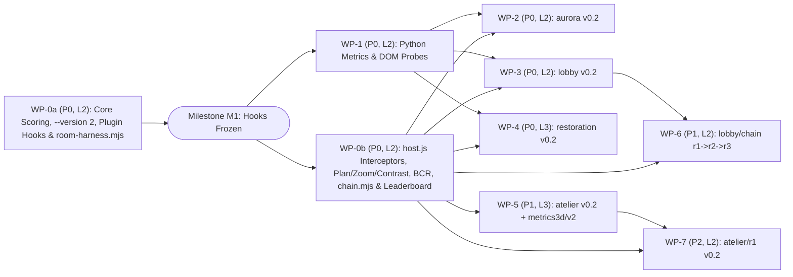

# MoL-Bench v0.2 — Complete Technical Design Specification

> **Status:** Revised after independent design review (all 10 findings resolved; ready for WP-0a implementation).  
> **Version:** `bench_version: "0.2.0"`, `spec_version: "0.2.0"`.  
> **Scope:** Design document only. v0.1 rooms (`rooms/`), hidden suites (`hidden/`), and pilot results (`results/`) remain untouched and gradeable side by side with v0.2 (`rooms-v2/`, `hidden-v2/`, `results-v2/`).

---

## 1. Diagnosis of v0.1 Pilot Saturation

The v0.1 pilot (24 graded runs across 18 model/effort configurations, 5 room tracks) confirmed that deterministic programmatic grading works end-to-end on a Windows laptop, but the leaderboard **cannot separate frontier models**: top models saturate near 9.5–10.0 across almost every room.

### 1.1 Quantitative Summary of v0.1 Pilot Results

| v0.1 Track | Runs | Observed Composite Range | Anchors / Notes | Primary Saturation Causes |
|---|---:|---|---|---|
| `lobby` (Build) | 18 | **8.63 – 9.97** (8 models tied at **9.97**) | Haiku max, Sonnet max, Opus high, Hydrogen high/xhigh, Neon med/high/xhigh all tied at `9.97` | **6 of 24 metrics returned `null` and silently dropped out of axis weights** (`theme.both_valid`, `a11y.reduced_motion_transition_ms`, `lh.lcp_ms`, `lh.cls`, `budget.transfer_kb`, `nav.transition_ms`); remaining CSS/typography bands passed trivially on first attempt; `tests.hidden` had weight `1` out of `17` computed craft weight so failing 1/7 hidden tests still yielded `craft = 9.9` and `composite = 9.97`. |
| `atelier` (Build) | 2 | **9.45 – 9.66** (Haiku high `9.66` > Sonnet high `9.45`) | Both scored **10.00 Craft** (`shape.iou_hidden` `0.989`–`0.995`) | `blueprint/dimensions.json` handed over every exact coordinate and radius of a regular hexagonal prism (no visual inference required); `vq.texel_density_cv` returned `null` when untextured and dropped out; Haiku beat Sonnet solely because `vq.detail_scale` had a hyper-narrow `[0.95, 1.00]` ideal band (`1.015` → `3.8`, `1.028` → `0.0`). |
| `aurora` (Build) | 0 runs (anchors calibrated) | `a8` = **9.93** | Static wallpaper attack once got free palette score (fixed via `G-alive`) | Single-layer fBM + static palette conversion cleared every craft/VQ band easily; `perf.frame_p95_norm_ms` was disabled by default (`--perf` off) and uncalibrated for battery vs. AC laptop power states; global `lum.mean` / `palette_fidelity` lacked spatial and physical-consistency constraints. |
| `restoration` (Build) | 2 | **8.35 – 9.32** (Haiku high `8.35`, Sonnet high `9.32`) | Both scored **10/10** on `bugs.fixed`, `tests.hidden`, `rootcause.accuracy` | The 4 planted bugs (`B1`–`B8`) were isolated, non-interacting 1–8 line textbook Three.js bugs with syntactically loud code (e.g. duplicate `convertLinearToSRGB()` calls, `if (width < height)` resize guard, deleted `.dispose()` loop with tracking arrays still present) and 1:1 bilingual giveaway complaints. Score loss came mostly from harness/band bugs (`diff.out_of_scope_files = 15–22` from workspace artifacts; `render.aliasing = 0.044` vs zero threshold `0.042` on the reference scene itself). |
| `lobby/r1` (Renovation) | 1 | **7.25** (Haiku high) | Spec/capture incomplete during pilot | `mask.element_ssim`, `layout.shift_px`, `lh.cls`, and `lh.lcp_ms` all returned `null` (start-state capture was added late); `text.line_length` and `space.grid4_frac` scored `0` largely due to `a5` baseline traits rather than bad edits. |
| `atelier/r1` (Renovation) | 1 | **0.87** (Haiku high) | Failed `G-reproducible` (geometry hash mismatch) | Request scores themselves were high (`AT-R2` 9.5, `AT-R3` 10.0, `AT-R4` 10.0 — Haiku even achieved 180° door open!), showing individual requests were too easy once `G-reproducible` is met. |
| `aurora/r1` (Renovation) | 0 | — | Never swept | Low incremental signal over `aurora` Build + `lobby` Renovation; consuming quota on 7 tracks made full sweeps unaffordable. |

### 1.2 Observed v0.1 Token Baseline (`1.0×` Reference — Caveated)

From `results/*.json`, v0.1 `lobby` (Build) provides an initial reference point, **with the explicit caveat** that v0.1 `lobby` was saturated and agents finished early; harder v0.2 rooms with longer active-time limits will likely consume more tokens per run and **must be re-sized from measured Wave-0 canary telemetry (§6.2)**:

| Provider / CLI | v0.1 `lobby` Median Output Tokens | v0.1 `lobby` Median Total Tokens | Notes |
|---|---:|---:|---|
| Gemini / AGY (`Neon High`, `Hydrogen High`, `Flash High`) | **61k – 117k** (median ~**70k**) | **438k – 695k** (median ~**460k**) | Compact transcript accounting; available now. |
| Claude CLI (`Haiku`/`Sonnet`/`Opus` at `high`) | **54k – 95k** (median ~**65k**) | **5.6M – 8.8M** (median ~**6.0M**) | Dominated by `cache_read` (~95% of total); `max` effort exploded to `226k–248k` out / `26M–32M` total with zero score gain. |
| Codex CLI (`GPT-6-Luna high`) | **54k** | **10.5M** | Unavailable for ~3 weeks. |

**Key Lesson:** Difficulty must come from **depth, precision, coupled constraints, hidden-condition generalization, and genuine engineering trade-offs**, not from sheer volume of boilerplate.

---

## 2. Calibration Freeze Gates, Determinism & Version Coexistence

### 2.1 Hard Freeze Gates vs. Post-Hoc Reported Targets

To prevent hand-overfitting score bands to force a predicted score distribution, v0.2 strictly separates **Hard Freeze Gates** (must pass before a track is frozen) from **Post-Hoc Reported Targets** (observed on Wave-0 canaries and published transparently without circularly re-tuning bands to hit a magic number):

#### Hard Freeze Gates (Acceptance Criteria Before Track Freeze)

| Gate | Requirement |
|---|---|
| **Anchor monotonicity & bands** | `null ∈ [0.0, 1.0]` (fails ≥ 90% of hidden tests), `a5 ∈ [4.5, 5.5]`, `a8 ∈ [7.5, 8.5]`, and strict ordering **`composite(null) < composite(a5) < composite(a8)`** (plus per-metric `a8 ≥ a5 ≥ null` where meaningful). |
| **Expert-over-canary headroom** | **`composite(a8) ≥ composite(Wave-0 frontier canary)`** — the expert reference must not be saturated/beaten by the Wave-0 frontier canary before freeze. |
| **Tier monotonicity** | **`composite(Wave-0 frontier canary) > composite(Wave-0 fast canary)`** (e.g. `Gemini 4 Neon (High) > Gemini 3.8 Flash (High)`). |
| **Attack resistance** | Every attack submission (≥ 3 per track) scores **`composite < 3.0`**. |
| **Mutant sensitivity** | ≥ 5 single-defect mutants of `a8` per track; grader lowers composite on **≥ 4/5** (target **5/5**). |
| **Zero null required metrics** | Every required metric in `spec.metrics` produces a non-null score on `a5` and `a8`. |
| **Same-toolchain repeatability** | Two independent grades on the same machine & pinned toolchain produce **identical** non-perf raw values (`ε = 0`). |

#### Post-Hoc Reported Calibration Targets (Diagnostic, Not Acceptance Gates)

- **Headroom target:** Best current frontier model landing around **`5.5 – 7.0`** composite per track (leaving `1.0–2.5` points below `a8` for future model generations).
- **Tier spread target:** `≥ 1.5` composite point separation between fast/budget tier and frontier tier, with `≤ 2` models tied within `0.1`.
- If a Wave-0 frontier canary exceeds `a8` (failing the **Expert-over-canary** freeze gate), the room's hidden test complexity or `a8` craft bar is raised *before* Wave 1 begins; otherwise, the observed frontier canary score is reported as-is.

### 2.2 Determinism Guarantee, Toolchain Pinning & Epsilons

Pixel statistics (APCA screenshot sampling, sky/lake NCC, ridge rim-light correlation, FLIP) cannot be guaranteed bit-exact across arbitrary OSes, font versions, or SwiftShader builds. v0.2 therefore declares an explicit **same-machine, same-toolchain determinism guarantee** and pins the entire grading stack in the repository:

1. **Pinned Grading Toolchain (WP-0a / WP-0b):**
   - **Browser & SwiftShader:** Exact Playwright + bundled Chromium revision pinned in `package-lock.json` (`PLAYWRIGHT_BROWSERS_PATH=0`), launched with fixed flags (`--use-angle=swiftshader --enable-unsafe-swiftshader --force-color-profile=srgb --font-render-hinting=none --disable-lcd-text`).
   - **Repo-Vendored Fonts (`harness/fonts/`):** Pin exact WOFF2/TTF files (`Pretendard`, `Noto Sans JP`, `Inter`, `Noto Serif`) served locally and mapped via `@font-face` in seeds/prompts so OS font updates never drift text metrics or APCA crops.
   - **Python & Blender:** Exact versions pinned in `metrics/requirements.txt` (`numpy`, `scipy`, `scikit-image`, `opencv-python-headless`, `colour-science`) and fixed Blender `5.3.x` CPU build (Cycles CPU, fixed seed, fixed thread count, denoiser off).
   - **Provenance Stamp:** Every `results-v2/<run-id>.json` records a `toolchain` block (`chromium_version`, `swiftshader_renderer`, `blender_version`, `node_version`, `python_version`, `os_platform`).
2. **Stated Repeatability & Cross-Environment Epsilons:**

| Metric Class | Same-Machine, Same-Toolchain | Cross-Machine / Patch-Upgrade Epsilon (Informational) |
|---|---|---|
| Gates, DOM counts, `budget.*`, `tests.*`, `diff.*`, 3D topology/kinematics/clearance | **Exact (`ε = 0`)** | **Exact (`ε = 0`)** |
| SwiftShader pixel SHA-256 (`G-determinism`) | **Bit-identical** | N/A (same-machine gate only) |
| Pixel spatial/correlation metrics (`reflection_coherence`, `terrain_lighting`, `water_ripple`, `palette_band_sep`, `banding`, `aliasing`, `mask.element_ssim`) | **Exact (`ε = 0`)** | **`±0.015`** raw (≤ `0.15` composite pts) |
| Screenshot-sampled APCA contrast (`a11y.apca_contrast`) | **Exact (`ε = 0`)** | **`±1.5 Lc`** (uses median background sampling outside a 2 px anti-aliased glyph halo to suppress subpixel AA jitter) |
| Blender Cycles CPU renders (`shape.iou_*`, `render.lod_fidelity`, `vq.*`) | **Exact (`ε = 0`)** | **`±0.5%`** relative (matching `docs/SCORING.md`) |
| Informational BCR timing (`perf.*`, `weight: 0`) | **Diagnostic only** | **Unranked until empirically validated on AC vs. battery (§3.1A)** |

### 2.3 Fail-Closed Metric Scoring (No Silent Null-Drops)

In v0.1, `harness/src/score.mjs` omitted any `score === null` metric from `wSum`, silently erasing 6 craft/VQ metrics in `lobby` and 1 in `atelier`.

**v0.2 Rule (`spec.fail_closed: true`, default for all `0.2.x` specs):**
1. Every scored metric (`weight > 0`) in `spec.metrics` and `spec.requests[].metrics` is **required** (zero optional/droppable scored metrics in v0.2 tracks).
2. During normal grading (`!noCapture && !noPython`), any required metric returning `null` or `undefined` scores **`0`** (keeping its weight in `wSum`) and appends a `missing_required_metric` warning.
3. Metrics explicitly marked `"informational": true` (`weight: 0`, e.g. BCR `perf.*`) are computed and stored in `results-v2/<run-id>.json` without affecting axis averages or failing grading if unstable.
4. For `spec_version: "0.1.x"`, v0.1 behavior is preserved verbatim under `--version 1` so v0.1 results remain reproducibly re-gradeable.

### 2.4 Side-by-Side Coexistence of v0.1 and v0.2

v0.1 rooms, hidden assets, and results are **never overwritten or moved**. v0.2 lives in parallel versioned directories:

```text
rooms/                  # v0.1 rooms — UNTOUCHED
hidden/                 # v0.1 hidden tests/refs/grade.json — UNTOUCHED
results/                # v0.1 graded results + v0.1 leaderboard.md — UNTOUCHED
harness/src/rooms/      # v0.1 room adapters — UNTOUCHED

rooms-v2/               # v0.2 rooms: aurora, lobby, restoration, atelier (+ renovation subdirs)
hidden-v2/              # v0.2 hidden tests, grade.json, refs, masks, reference/, mutants/
results-v2/             # v0.2 graded results (<run-id>.json), submissions/, leaderboard.md
harness/src/rooms-v2/   # v0.2 room adapters (aurora.mjs, lobby.mjs, restoration.mjs, atelier.mjs)
harness/fonts/          # Repo-vendored deterministic OFL fonts for v0.2 web rooms
metrics3d/v2/           # v0.2 Blender 3D blueprint, kinematics, clearance, UV/bake, LOD evaluators
```

**CLI & Runner Resolution:**
- `bench grade <room> <dir> [--version 2]` defaults to `--version 1`; `--version 2` (or `.bench-room` containing `{"room":"aurora","version":2}`) resolves specs from `rooms-v2/`, hidden assets from `hidden-v2/`, and adapters from `harness/src/rooms-v2/`.
- `node runner/prepare.mjs <room> --version 2 --run-id <id> [--renovation <r>]` writes `"bench_version": "0.2.0"` into `.run.json` and `.bench-room`, copies only `rooms-v2/<room>/seed` (never `hidden-v2/`), and sanitizes private spec keys identically to v0.1.
- `node runner/collect.mjs <id> --model "<label>"` reads `bench_version` from `.run.json` and writes automatically to `results-v2/` for `0.2.x` or `results/` for `0.1.x`.
- `node harness/src/leaderboard.mjs` generates `results/leaderboard.md` (v0.1, untouched unless `--version 1`/`--all`), `results-v2/leaderboard.md` (v0.2), and `site/leaderboard/{data.json,index.html}` with a **`v0.2` | `v0.1` version switcher**.

---

## 3. Power-State Robust Performance & Within-Provider Efficiency

### 3.1 Scored Performance = Combined Deterministic Work Counts; BCR `perf.*` = Informational Until Validated

Because the grading host is a laptop that runs on AC or battery and travels — and because GPU/CPU throttling shifts ALU, memory bandwidth, and clock frequencies by different ratios across different workloads — **v0.2 does NOT rely on wall-clock timing or unvalidated BCR ratios for scored points**:

#### A. Scored Signal: Multi-Channel Deterministic Work Budgets (`0%` Power-State Variance)

No single static counter is trusted alone (closing the reviewer's shader-ALU gaming loopholes such as offloading work to texture LUTs, vertex shaders, extra FBO passes, or JS bake tables). Every web track scores a **combined multi-channel `budget.*` profile** intercepted directly by `harness/src/capture/host.js` and CDP:

1. **WebGL Combined Work Budget (`aurora` v0.2, `restoration` v0.2):**
   - `budget.draw_calls` — Actual `gl.drawArrays*` / `gl.drawElements*` / `*Instanced` calls intercepted by `host.js` per `renderFrame()` (replaces self-reported `stats().drawCalls`).
   - `budget.render_passes` — Actual `gl.bindFramebuffer` target switches + total viewport-normalized pixel fill `Σ (target_w * target_h) / (vp_w * vp_h)` per frame (prevents hiding cost across oversized or numerous offscreen FBOs).
   - `budget.gpu_work_profile` — **Worst-of-4-channels** composite budget (scored `[0, 10]` via minimum across the 4 sub-channels so gaming one channel by shifting cost to another immediately triggers another sub-channel!):
     1. **Unified Shader Op-Count (`vertex + fragment`):** `molmetrics/budget_glsl.py` parses **both** active vertex and fragment shaders captured via hooked `gl.shaderSource`/`gl.linkProgram`. Constant-bound loops are expanded; dynamic/uniform-bound loops without static upper bound count as worst-case `32` iterations. Weights: `1` ALU op, `4` transcendental (`sin/cos/exp/pow/log/sqrt`), `2` branch, **`16` texture fetch (`texture*`)** (penalizing LUT offloading).
     2. **Geometry & Vertex Throughput (`vertices_drawn`):** Hooked total vertex count submitted per frame (`aurora`: full `≤ 12` vertices for fullscreen quad/tri, zero `≥ 2000` — blocks vertex-shader tessellation offloading!).
     3. **Runtime Texture & Buffer Upload Budget (`tex_upload_kb`):** Hooked `gl.texImage2D` / `gl.texSubImage2D` / `gl.bufferData` byte total (`aurora`: full `≤ 16 KB`, zero `≥ 128 KB` — blocks JS-precomputed noise/LUT texture baking!).
     4. **Per-Frame GL API Call & Bundle Cap (`gl_calls_per_frame` + `bundle_gz_kb`):** Hooked WebGL call count per frame (`aurora`: full `≤ 35`, zero `≥ 150`) and compressed bundle size (`≤ 24 KB` gz — blocks embedding large static JS lookup tables!).
2. **DOM Combined Work Budget (`lobby` v0.2, `lobby/chain`):**
   - `budget.dom_mutations_per_step` — Mean DOM node insertions/removals per filter/sort step (captured via `MutationObserver` during the 12-step scripted flow on the 48-room stress variant): full `≤ 55`, zero `≥ 300` (catches full-list DOM tear-down/recreation per keystroke).
   - `budget.layout_reads_per_step` — Hooked forced-layout property/method reads (`getBoundingClientRect`, `offsetWidth/Height`, `clientWidth/Height`, `scrollWidth/Height`, `getComputedStyle`) per scripted step: full `≤ 4`, zero `≥ 25` (catches layout thrashing).
   - `budget.dom_nodes` — Total DOM nodes on the 48-room variant: full `≤ 650`, zero `≥ 1800`.
   - `budget.transfer_kb` — Total CDP `Network.loadingFinished` `encodedDataLength / 1024`: full `≤ 120 KB`, zero `≥ 500 KB`.
   - `perf.cls` — Deterministic `PerformanceObserver({ type: 'layout-shift', buffered: true })` CLS across load + font ready + scripted flow: full `≤ 0.01`, zero `≥ 0.15`.

#### B. Informational Timing Signal: Bracketed Calibration Ratio (BCR, `weight: 0`)

`perf.frame_ratio` (WebGL) and `perf.interaction_ratio` (4× CPU-throttled DOM) remain implemented in WP-0b as **`informational: true` (`weight: 0`) diagnostic metrics** until empirically proven stable on AC vs. battery:

1. **Interleaved Bracketing (`K = 5` rounds):** Each round `i` runs `[C_pre,i, S_i, C_post,i]` inside one browser session (`webgl_cal.html` for GPU p95 frame time; `dom_cal.html` under CDP `Emulation.setCPUThrottlingRate(4)` for DOM interaction duration). `C_bar,i = (C_pre,i + C_post,i)/2`, `r_i = S_i / C_bar,i`.
2. **Non-Blocking Stability Handling (No Regrade Loops):**
   - Round `i` is marked unstable if `|C_post,i - C_pre,i| / C_bar,i > 0.12`.
   - Session is marked `perf_cal_unstable: true` if `≥ 2` rounds are unstable or `IQR(C_bar) / median(C_bar) > 0.15`.
   - **Never aborts grading or triggers infinite retry loops** in default unattended mode: at most 1 short retry after a 10 s cooldown; if still unstable, logs `perf_cal_unstable: true` and stores `raw: null` on the `weight: 0` informational metric while completing the grade cleanly. (Optional `--strict-perf` CLI flag exits `75` only for dedicated local perf validation scripts.)
3. **Sanity Flag:** If a stable BCR run records `r > 2.5`, the result attaches an informational warning `perf_bcr_slow` so human reviewers can inspect whether a submission somehow bypassed `budget.*`.
4. **Empirical Promotion Bar (Optional Future Minor Bump):** BCR `perf.*` may only be promoted from `weight: 0` to low-weight (`wt ≤ 1`) after WP-0b/WP-2/WP-3 validate on the actual host laptop that `|median_AC(r) - median_battery(r)| / median_AC(r) ≤ 0.10` across both `a5` and `a8` over 5 AC + 5 battery sessions.

### 3.2 Efficiency Reporting (Within-Provider Tokens Only; `active_min` Per-CLI Diagnostic)

> **Integration Note (WP-0b):** A parallel worker already implements `active_min` (sum of inter-event gaps in agent logs/transcripts, each gap capped at `5.0 min`) and awake-time limit enforcement in `runner/hc/autopilot.sh`, `runner/collect.mjs`, `runner/tokens.mjs`, and `harness/src/leaderboard.mjs`. **WP-0b builds directly on that branch and does NOT re-implement active-time collection.**

#### Schema in `results-v2/<run-id>.json`

```json
"efficiency": {
  "provider_group": "gemini|claude|codex|argon",
  "cli_source": "agy|claude|codex|orchestra",
  "active_min": 18.4,
  "wall_min": 142.7,
  "time_limit_active_min": 45,
  "timed_out_active": false,
  "tokens": {
    "input": 380000,
    "output": 64200,
    "reasoning": 18400,
    "cache_read": 0,
    "cache_write": 0,
    "total": 462600
  },
  "provider_tok_ratio": 1.12
}
```

#### Rules for Efficiency & Leaderboard Ranking

1. **Composite Separation (Preserved):** Efficiency is **never blended into `composite`**.
2. **Within-Provider Token Comparison Only (No Assumed Cross-Provider Price Ratios):**
   - Token accounting differs fundamentally across CLIs/providers (e.g. Claude CLI logs `5M–32M` `cache_read` tokens; AGY logs compact uncached totals; API pricing ratios differ by provider).
   - Therefore, v0.2 **does NOT compute a cross-provider `weighted_k` or cross-provider `efficiency_score`**.
   - Instead, the leaderboard reports raw provider-native tokens (`Out+Reas`, `Total`, `Cache Read`) and computes **`provider_tok_ratio`** (`(output + reasoning) / median_provider_wave0_out_reas`) and **Pareto-frontier badges strictly within the same `provider_group`** (e.g., comparing `Gemini 4 Neon High` vs. `Neon Med` vs. `Flash High`; or `Claude Opus` vs. `Sonnet` vs. `Haiku`).
   - Baseline token denominators for each `(track, provider_group)` are populated empirically from Wave-0 / initial provider runs in `results-v2/efficiency-baselines.json` — never guessed ahead of time.
3. **`active_min` Is Reported Per-CLI, Never Ranked Across CLIs:**
   - Because `agy`, `claude`, and `codex` emit log events at different granularities, `active_min` is displayed as a diagnostic column (`Active (min)`) and used strictly to enforce `time_limit_active_min` (replacing unreliable `wall_min` on a sleeping laptop). It is **never** used to rank or tie-break models across different CLIs.
4. **Leaderboard Sorting & Tie-Breaking:**
   - Primary sort: `composite` descending (`0.01` precision internally, `0.1` displayed).
   - Tie-breaker when `|composite_A - composite_B| < 0.05`: `reliability` desc → (if same `provider_group`: lower `output + reasoning` tokens; if different `provider_group`: tie, ordered alphabetically by `run_id`).

---

## 4. MoL-Bench v0.2 Room Suite (6 Tracks Total)

### 4.1 Disposition of v0.1 Tracks & Provisional Cost Planning

| Track | v0.1 Status | v0.2 Disposition | Priority | Provisional Cost Bound vs. v0.1 `lobby` *(re-measured in Wave 0)* |
|---|---|---|---|---:|
| `aurora` (Build) | Saturated (`a8 = 9.93`) | **Overhauled** (`rooms-v2/aurora`) | **P0** | `~1.3× – 1.8×` |
| `lobby` (Build) | Saturated (8 models at `9.97`) | **Overhauled** (`rooms-v2/lobby`) | **P0** | `~1.4× – 2.0×` |
| `restoration` (Build) | Saturated (`8.35–9.32`, 10/10 bugs) | **Overhauled** (`rooms-v2/restoration`) | **P0** | `~1.5× – 2.2×` |
| `atelier` (Build) | Saturated (`9.45–9.66`, 10/10 craft) | **Overhauled** (`rooms-v2/atelier`) | **P1** | `~1.6× – 2.3×` |
| `lobby/chain` (`r1→r2→r3`) | *Replaces single-shot `lobby/r1`* | **New Chained Renovation** (`rooms-v2/lobby/renovation/chain`) | **P1** | **Capped `≤ 2.0×` measured Wave-0 `lobby` v0.2** (pilot-sized §4.6) |
| `atelier/r1` (Renovation) | Broken gate (`0.87`) / easy reqs | **Overhauled** (`rooms-v2/atelier/renovation/r1`) | **P2** (optional) | `~1.2× – 1.6×` |
| `aurora/r1` (Renovation) | Never swept | **Retired** (saves quota; aesthetic/work-budget tension moved into `aurora` v0.2) | — | — |
| `lobby/r1` (single-shot) | Replaced | **Retired** (subsumed by `lobby/chain`) | — | — |

---

### 4.2 Track 1: `aurora` v0.2 (Build — P0)
**"Boreal Fjord — Real-Time Shader Under Quality-vs-Work-Budget Trade-Offs"**

- **What is measured:** Multi-layered WebGL2 shader craft, physical light/reflection coupling, spatial-temporal visual hygiene, generalization across extreme unseen viewports and OKLCH palettes, and algorithmic efficiency under a multi-channel deterministic GPU work budget.
- **Prompt outline:**
  - Build a full-viewport WebGL2 real-time aurora borealis over a dark mountain ridge **and a calm alpine fjord lake** in `room/index.html` (`≤ 2` draw calls, `0` raster/external assets, `0` network requests).
  - Visual requirements:
    1. Multi-curtain aurora driven dynamically by `params.palette` (3 OKLCH colors) with vertical ray structure and distinct vertical altitude separation between palette bands.
    2. Star field with smooth sub-10 Hz twinkle and aspect-correct circular stars across any resize.
    3. Procedural horizon silhouette occupying the middle-lower band (`y ∈ [0.54H, 0.70H]` parameterized by `params.horizonY`), **with dynamic aurora rim-lighting along the ridge crest** coupled to overhead aurora brightness.
    4. **Alpine lake below the horizon (`y > horizon`)** showing a physically consistent, softly rippled, Fresnel-attenuated inverted reflection of the aurora and brightest stars.
    5. Smooth pointer parallax + vertical tilt (`pointer = [x, y]`), spatial dithering (zero 8-bit banding), `prefers-reduced-motion: reduce` (smooth freeze/slow without blanking), and `prefers-contrast: more` (boosted ridge/sky separation).
  - Deliverables: `room/index.html`, `report.json`. Active-time limit: **45 min**.
- **Seed / start state:** Minimal WebGL2 shell (`rooms-v2/aurora/seed/`) implementing `BenchRoom` v1 boilerplate + uniform plumbing for `params`, rendering a flat dark canvas (fails `G-alive` and all visual metrics).
- **Hidden conditions (`hidden-v2/aurora/grade.json`):**
  - **4 unseen seeds** with extreme perturbed OKLCH palettes (narrow-hue high-chroma green/cyan + low-L violet; warm solar-storm crimson/amber), unseen `horizonY ∈ [0.54, 0.70]`, `waterRoughness ∈ [0.2, 0.8]`, `starDensity ∈ {sparse, normal, dense}`, `motionScale ∈ [0.6, 1.5]`.
  - **Unseen viewports:** public `["1440x900", "768x1024", "360x780"]`; hidden adds **ultrawide `2560x640`** and **narrow `320x720`**.
  - **Unseen timestamps:** `[333, 1850, 4720, 8110, 15400, 29300]` ms.
  - **Unseen pointer trajectory** (`[0.1, 0.2] → [0.9, 0.85]`) + resize stress `2560x640 → 320x720 → 1440x900` at DPR 2.
- **Gates:** `G-load` (≤ 12s SwiftShader), `G-console`, `G-contract`, `G-determinism`, `G-live` (FLIP ≤ 0.015), `G-alive` (median `time.motion > 0.0008`), `G-offline`, `G-raster` (0 KB — pure shader), `G-report`.
- **Composite weights:** `craft: 0.45`, `visual_quality: 0.40`, `reliability: 0.15`.
- **Metrics, Weights, Bands & Algorithm Deltas vs. `docs/METRICS.md`:**

| Metric ID | Axis | Wt | Score Type & Bands | `at` / `agg` | Algorithm / Delta vs. `docs/METRICS.md` |
|---|---|---:|---|---|---|
| `color.palette_fidelity` | craft | 2 | `higher` full `0.88`, zero `0.50` | all vps, all ts / `median` | Same as v0.1, restricted to sky (`y < h(x)`) with tighter ΔE_OK `< 0.08`. |
| `color.palette_band_sep` | craft | 3 | `higher` full `0.75`, zero `0.25` | `1440x900`, all ts / `median` | **NEW (`molmetrics/spatial.py`):** All 3 palette colors have ≥ 6% chromatic pixel share AND vertical altitude stratification `std(y_0,y_1,y_2) ≥ 0.045`. |
| `scene.reflection_coherence` | craft | 3 | `higher` full `0.62`, zero `0.20` | `1440x900`, `t in [1850, 8110]` / `median` | **NEW (`molmetrics/reflection.py`):** Normalized cross-correlation (NCC) of blurred (`σ=6`) OKLab `L,a,b` between vertically mirrored sky strip above `h(x)` and lake strip below `h(x)`, multiplied by `fresnel_ok` (`mean L_lake < 0.85 * mean L_sky`). |
| `scene.water_ripple` | craft | 2 | `range` ideal `[0.015, 0.12]`, zero `[0.0, 0.30]` | `1440x900`, `t=4720` / `median` | **NEW (`molmetrics/reflection.py`):** Lake horizontal-vs-vertical gradient anisotropy scaled by lake-vs-mirrored-sky FLIP (rejects both unrippled mirror copies and static noise). |
| `scene.terrain_lighting` | craft | 2 | `higher` full `0.55`, zero `0.10` | `1440x900`, all ts / `median` | **NEW (`molmetrics/reflection.py`):** Pearson correlation `r` between 32-column overhead aurora luminance (40 px above `h(x)`) and ridge-crest rim luminance (6 px below `h(x)`), requiring dark ridge interior (`L < 0.07`). |
| `scene.star_count` | craft | 1 | `range` ideal `[90, 500]`, zero `[10, 2000]` × `starDensity` | `1440x900`, `t=333` | Restricted strictly to sky (`y < h(x) - 8`). |
| `scene.star_roundness` | craft | 2 | `range` ideal `[0.88, 1.14]`, zero `[0.65, 1.60]` | `after resize 2560x640 -> 320x720 -> 1440x900`, DPR 2 / `worst` | Tighter band + extreme ultrawide/narrow resize sequence. |
| `interact.pointer_response` | craft | 1 | `range` ideal `[0.015, 0.075]`, zero `[0.002, 0.22]` | `1440x900`, `t=4720` | Evaluates 2D shift (`[0.1,0.2]` vs `[0.9,0.85]`). |
| `a11y.reduced_motion` | craft | 2 | `lower` full `0.002`, zero `0.012` | `1440x900` | Paired with `reduced_motion.not_blank` (forced `0` if blank). |
| `budget.gpu_work_profile` | craft | 4 | `higher` full `1.0`, zero `0.0` | `1440x900` static+hooked | **NEW (§3.1A):** Deterministic **minimum across 4 anti-gaming channels**: (1) unified `vertex+fragment` shader op-count (`≤ 650` full / `≥ 2200` zero, `16×` per texture fetch), (2) `vertices_drawn` (`≤ 12` / `≥ 2000`), (3) `tex_upload_kb` (`≤ 16 KB` / `≥ 128 KB`), (4) `gl_calls_per_frame ≤ 35` & `bundle_gz_kb ≤ 24 KB`. |
| `budget.render_passes` | craft | 2 | `lower` full `2.0`, zero `6.0` | `1440x900` hooked | Hooked FBO switches + viewport-normalized pixel fill (§3.1A). |
| `budget.draw_calls` | craft | 1 | `lower` full `2`, zero `10` | `1440x900` hooked | Hooked WebGL2 draw calls (`host.js`). |
| `tests.hidden` | craft | 2 | `ratio` | hidden tests | `prefers-contrast: more`, seed round-trip `A→B→A`, `resume()` continuity, ultrawide/narrow resize, `horizonY` adherence. |
| `perf.frame_ratio` | craft | **0** | *(informational)* | `1440x900` GPU BCR | **Informational only (`weight: 0`)** until AC-vs-battery validated (§3.1B). Flags `perf_bcr_slow` if `> 2.5`. |
| `time.motion` | visual_quality | 2 | `range` ideal `[0.0025, 0.014]`, zero `[0.0008, 0.050]` × `motionScale` | `1440x900` | Tightened; `motionScale` proportionality checked in hidden tests. |
| `time.flicker` | visual_quality | 3 | `lower` full `0.10`, zero `0.35` | `1440x900`, `t0=2500` | Tightened vs. v0.1 (`0.15 / 0.50`). |
| `render.banding` | visual_quality | 3 | `lower` full `0.001`, zero `0.009` | all vps, all ts / `worst` | Tightened + **`worst`** aggregation across viewports. |
| `render.aliasing` | visual_quality | 2 | `lower` full `0.012`, zero `0.042` | `1440x900`, `2560x640`, `t=4720` / `worst` | Checks ridge & lake horizon aliasing. |
| `lum.dynamic_range` | visual_quality | 2 | `range` sky mean L `[0.10, 0.24]` + highlight `[0.004, 0.05]` | all vps, all ts / `median` | Combined sky luminance & highlight balance. |
| `report.honesty` / `autonomy` | reliability | 6 / 4 | `higher` `10 / 0` | — | Unchanged (`docs/SCORING.md §5`). |

- **Anchors:** `null` (`0.0`, fails `G-alive`), `a5` (`~4.9` — basic single-pass aurora + crude unrippled mirror + no rim lighting + bloated ALU ~1300), `a8` (`~8.1` — optimized analytic multi-curtain aurora, rippled Fresnel lake reflection, dynamic ridge rim light, blue-noise/IGN dithering, `gpu_work_profile ≈ 0.95`, `passes = 1`, `draw_calls = 1`).
- **Attacks (all `< 3.0`):**
  1. `palette-mirror-fake`: oscillating palette stripes mirrored horizontally → fails `scene.water_ripple`, `scene.terrain_lighting`, `scene.star_count`, `tests.hidden` (`< 2.5`).
  2. `lut-offload-hack`: bakes aurora into a large JS-uploaded 2D LUT texture or vertex grid to dodge fragment ALU → caught by `budget.gpu_work_profile` (`tex_upload_kb` / `vertices_drawn` / `16×` texture penalty) + fails `terrain_lighting` & hidden palette perturbation (`< 2.8`).
  3. `flat-black-stars`: near-black sky with twinkling stars and solid black lake → fails `palette_fidelity`, `palette_band_sep`, `reflection_coherence`, `terrain_lighting` (`< 2.2`).
- **Expected failure modes of frontier models:** Hardcoding `horizonY` instead of reading `params.horizonY`; stretching stars/clipping reflection at `2560x640` ultrawide; blowing `budget.gpu_work_profile` via brute-force 32+ step loops or unrolled FBM; forgetting Fresnel attenuation or ripple anisotropy in the lake; omitting temporal coupling between overhead aurora and ridge rim light.

---

### 4.3 Track 2: `lobby` v0.2 (Build — P0)
**"Museum Catalog & Entrance — Interactive Editorial App Under Hidden Edge Conditions"**

- **What is measured:** Production-grade responsive editorial UI, trilingual typography (`ko`/`en`/`ja` with repo-vendored fonts), interactive client-side state (search, category filter, sort, accessible detail drawer, URL state sync), WCAG + APCA contrast across `light`, `dark`, and `prefers-contrast: more`, zero layout overlap at `320px` and `200%` text zoom, and deterministic DOM mutation/reflow discipline.
- **Prompt outline:**
  - Build the Museum of Light interactive catalog at `lobby/index.html` consuming `window.__benchHost.params.rooms` (`id`, `route`, `title_ko`, `title_en`, `title_ja`, `summary_ko`, `summary_en`, `summary_ja`, `category` ∈ `{light, sound, kinetic, archive}`, `duration_min`, `tags[]`, `accent_oklch`, `status` ∈ `{open, coming_soon}`).
  - Required `[data-bench]` landmarks: `header`, `hero-title`, `search-input`, `filter-bar`, `sort-select` (`default|title|duration`), `lang-toggle` (`ko|en|ja`), `theme-toggle` (`light|dark`), `room-card`, `body`, `empty-state`, `detail-drawer`, `footer`.
  - Interactive invariants:
    1. Filter, search, sort, language, and open room sync bidirectionally with URL hash/query (`#/?q=...&cat=...&sort=...&lang=...`) and survive browser Back/Forward + reload.
    2. Opening `detail-drawer` traps Tab focus inside the drawer, closes on `Escape` or backdrop click, and restores focus to the exact triggering card.
    3. `coming_soon` cards must be visibly distinct and `state().route` must never become a `coming_soon` id.
    4. Smooth deterministic drawer/navigation transitions (`160–420 ms`), collapsing to `≤ 50 ms` under `prefers-reduced-motion: reduce`.
  - Use only repo-vendored fonts in `lobby/fonts/` (copied from `harness/fonts/` by seed) or system stacks; zero external network requests. Active-time limit: **50 min**.
- **Seed / start state:** Bare HTML skeleton (`rooms-v2/lobby/seed/`) with `BenchRoom` v1 stub and pinned local OFL font files in `lobby/fonts/`.
- **Hidden conditions (`hidden-v2/lobby/grade.json`):**
  - **Unseen viewports:** public `["360x780", "768x1024", "1440x900"]`; hidden adds **`320x568`**, **`1920x1080`**, and **`1440x900@zoom200`** (`html { font-size: 32px }` injected by harness).
  - **Unseen locales & extreme data:** `ja` locale, `0` rooms, `1` room, **`48` rooms** (DOM mutation/node stress), **52-char unspaced Latin slug title**, **42-syllable Hangul title**, mixed CJK+Latin+numbers summary, and `prefers-contrast: more`.
  - **Unseen scripted interaction flow (`probes/flow.js`):** 10-checkpoint Playwright user sequence (search → category chip → sort by duration → keyboard Tab to 3rd card → Enter opens drawer → Tab wraps inside drawer → Esc closes & returns focus to exact 3rd card → Enter Room navigates → Back restores filter/sort/scroll → Reload preserves state).
- **Gates:** `G-load` (≤ 6s), `G-console`, `G-contract`, `G-determinism`, `G-offline`, `G-raster` (≤ 32 KB/file, 128 KB total), `G-fonts-local`, `G-report`.
- **Composite weights:** `craft: 0.45`, `visual_quality: 0.40`, `reliability: 0.15`.
- **Metrics (zero null-drops; all 6 v0.1 broken metrics fixed & hardened):**

| Metric ID | Axis | Wt | Score Type & Bands | `at` / `agg` | Algorithm / Delta vs. `docs/METRICS.md` |
|---|---|---:|---|---|---|
| `data.rooms_rendered` | craft | 2 | `ratio` | all vps, `normal\|many_48` / `worst` | Renders all 48 rooms cleanly. |
| `data.edge_cases` | craft | 2 | `ratio` | `320x568`, `1440x900@zoom200` | `empty_state`, 42-syllable Hangul title, 52-char unspaced Latin token, `ja` rendering, `1-room` max-width cap. |
| `interact.scripted_flow` | craft | 4 | `ratio` | `1440x900`, `360x780` / `worst` | **NEW (`probes/flow.js`):** 10-checkpoint hidden Playwright user script. |
| `layout.overflow_count` | craft | 3 | `lower` full `0`, zero `3` | all vps (incl. `320x568`, `zoom200`), both schemes / `worst` | Tightened (`5 → 3`). |
| `layout.overlap_count` | craft | 3 | `lower` full `0`, zero `4` | all vps (incl. `320x568`, `zoom200`), `normal\|lang_ja` / `worst` | **NEW (`probes/overlap.js`):** Pairwise AABB intersection check among visible sibling block/interactive elements (`> 2 px²`, excluding closed overlays). |
| `text.clipped_count` | craft | 2 | `lower` full `0`, zero `3` | all vps, `normal\|lang_en\|lang_ja` / `worst` | Tightened (`5 → 3`). |
| `a11y.axe_violations` | craft | 2 | `lower` full `0`, zero `5` | all vps, `light\|dark\|high_contrast` | Tightened (`10 → 5`) + includes `prefers-contrast: more`. |
| `a11y.apca_contrast` | craft | 2 | `higher` full `1.0`, zero `0.70` | `1440x900`, `light\|dark\|high_contrast` / `worst` | **NEW (`probes/contrast_apca.js`):** APCA `|Lc|` per visible text node against composited screenshot background (3×3 median sampled outside a 2 px anti-aliased glyph halo, `±1.5 Lc` cross-machine epsilon). Thresholds: `|Lc| ≥ 60` body (`≥ 75` high-contrast), `≥ 45` large headings. |
| `a11y.keyboard_focus` | craft | 2 | `ratio` | `360x780`, `1440x900` / `worst` | Combined `keyboard_reach` + `focus_visible`. |
| `theme.tri_valid` | craft | 1 | `pass` | `1440x900` | **Fixed (was null in v0.1):** Distinct pixel SHA-256 across `light`, `dark`, `prefers-contrast: more` + 0 contrast failures. |
| `a11y.reduced_motion_transition_ms` | craft | 1 | `lower` full `50`, zero `200` | `1440x900`, `reduced_motion` | **Fixed (was null in v0.1):** Wired via CDP virtual-time frame stepper. |
| `budget.dom_work_profile` | craft | 3 | `higher` full `1.0`, zero `0.0` | `1440x900`, `48 rooms`, scripted flow | **NEW (§3.1A):** Deterministic **minimum across 3 channels**: (1) `dom_mutations_per_step` (`≤ 55` / `≥ 300`), (2) `layout_reads_per_step` (`≤ 4` / `≥ 25`), (3) `dom_nodes` (`≤ 650` / `≥ 1800`). |
| `perf.cls` | craft | 2 | `lower` full `0.01`, zero `0.15` | `1440x900`, `320x568` / `worst` | **Fixed (replaces null `lh.cls`):** Deterministic `PerformanceObserver` CLS. |
| `budget.transfer_kb` | craft | 1 | `lower` full `120`, zero `500` | `1440x900` | **Fixed (was null in v0.1):** Actual CDP `encodedDataLength` sum. |
| `tests.hidden` | craft | 2 | `ratio` | hidden tests | Heading hierarchy, `coming_soon` non-navigation, `html[lang]` sync across `ko/en/ja`, ARIA dialog roles. |
| `perf.interaction_ratio` | craft | **0** | *(informational)* | `1440x900`, `48 rooms`, 4× CPU BCR | **Informational only (`weight: 0`)** until AC-vs-battery validated (§3.1B). |
| `text.hangul_midword_breaks` | visual_quality | 2 | `lower` full `0`, zero `5` | all vps / `worst` | Tightened (`10 → 5`). |
| `text.line_length` | visual_quality | 2 | `range` `ko:[22,42]` / `ja:[20,38]` / `en:[48,80]` | `1440x900`, `768x1024`, `lang_ko\|lang_en\|lang_ja` | Adds Japanese band and tightens ranges. |
| `text.line_height` | visual_quality | 1 | `range` `cjk:[1.55,1.85]` / `latin:[1.4,1.7]` | all vps | Tightened. |
| `type.hierarchy` | visual_quality | 2 | `higher` full `1.0`, zero `0.4` | `1440x900` | `size_steps ∈ [4,6]` + `scale_ratio_min ≥ 1.15` + H1/body `≥ 1.8`. |
| `space.grid4_frac` | visual_quality | 2 | `higher` full `0.94`, zero `0.65` | all vps / `worst` | Tightened + `worst` viewport agg. |
| `align.column_count` | visual_quality | 1 | `lower` full `6`, zero `14` | `1440x900` | Tightened (`8/20 → 6/14`). |
| `nav.transition_ms` | visual_quality | 2 | `range` ideal `[160, 420]`, zero `[0, 1000]` | `1440x900` | **Fixed (was null in v0.1):** Wired via CDP virtual time. |
| `visual.congestion` | visual_quality | 2 | `range` calibrated `[a8-12%, a8+12%]`, zero `±35%` | `1440x900`, `light\|dark` / `worst` | Evaluated in both light and dark schemes. |
| `report.honesty` / `autonomy` | reliability | 6 / 4 | `higher` `10 / 0` | — | Unchanged. |

- **Anchors:** `null` (`~0.6`), `a5` (`~5.1`), `a8` (`~8.2`).
- **Attacks (all `< 3.0`):** `plain-list` (`< 2.6`), `static-no-state` (`< 2.1`), `dom-bloat-redraw` (rebuilds all 48 cards + forced layout reads per keystroke + `px`-locked fonts overlapping at `zoom200` → `< 2.6`).
- **Expected failure modes of frontier models:** Overlap at `200%` root font zoom; dropping focus trap or Esc focus restoration in `detail-drawer`; losing filter/sort state on Back/reload; failing APCA contrast on `accent_oklch` badges in dark/high-contrast; tearing down and rebuilding all 48 card DOM nodes on every filter step (failing `budget.dom_work_profile`).

---

### 4.4 Track 3: `restoration` v0.2 (Build — P0)
**"The Fractured Planetarium — Interacting, Masking & Timing Multi-Bug Restoration"**

- **What is measured:** Deep root-cause debugging of **6 interacting visual, graphics-pipeline, memory, and concurrency bugs** in a modular Three.js Planetarium (`room/src/modules/{tonemap,materials,shadows,cache,seed_loader,post_resize}.js` + `main.js`), minimal surgical fixes, root-cause classification (20-code decoy taxonomy), and **black-box mutant-verified behavioral regression tests**.
- **Prompt outline:**
  - Agent receives the broken Planetarium workspace and **4 synthesized, vague visitor/curator complaints** (not 1:1 with the 6 planted bugs — Pair 1's complaint conceals a masking pair so fixing symptom #1 reveals defect #2).
  - Agent must fix all **6** bugs minimally in `room/src/**`, write **black-box behavioral regression tests** in `tests/regression/**` using the workspace's provided `bench/testing/room-harness.mjs` API (no direct `room/src` imports or `fs` inspection!), and classify all 6 root causes from the **20-code public taxonomy** (10 real codes + 10 plausible decoys) in `report.json → room.bugs[]`.
  - Active-time limit: **75 min**.
- **Pruned, Verifiable 10-Bug Modular Pool (4 Total Variants: 2 Public + 2 Hidden):**
  - Every bug resides cleanly inside **one dedicated module file** (`room/src/modules/<mod>.js`), enabling **exact full-file module replacement** to construct clean single-bug mutants without ever patching agent-edited files!
  - **Pair 1 — Verified Masking Pair (`tonemap.js` masks `materials.js`; 2 variants):**
    - Variant 1a: `POSTFX_DOUBLE_TONEMAP` (`tonemap.js`) masks `NORMAL_MAP_GREEN_INVERTED` (`materials.js`).
    - Variant 1b: `PREMULT_ALPHA_DOME_FOG` (`tonemap.js`) masks `DATA_TEXTURE_SRGB_DECODE` (`materials.js`).
    - **Deterministic Masking Proof (verified by WP-4 unit test before freeze):**
      1. With **both** A1 and A2 planted, toggling A2 alone shifts A2's isolated metric (`normal.specular_flip` / `metal.roughness_flip`) by **`< 0.015`** FLIP (proving A1 masks A2!).
      2. With **A1 fixed and A2 planted**, A2's metric degrades by **`≥ 0.08`** FLIP (dropping score from `10.0` to `≤ 3.0`), proving A2 is deterministically unmasked once A1 is fixed.
  - **Pair 2 — Coupled Trade-Off Pair (`shadows.js` + `cache.js`; fixed across all 4 variants):**
    - `SHADOW_BIAS_ACNE_VS_DETACH` (`shadows.js` — naive high bias triggers peter-panning caught by `shadow.contact_iou`, naive `polygonOffset` breaks glass dome sorting).
    - `SHARED_RESOURCE_DISPOSE_TRAP` (`cache.js` — unmount leaks per-mount GPU buffers while planets share a module-level base geometry cache; naive recursive `.dispose()` blanks the 2nd `mount()`!).
  - **Pair 3 — Timing / Concurrency & Hidden-Condition Pair (`seed_loader.js` + `post_resize.js`; 2 variants):**
    - Variant 3a: `ASYNC_SEED_RACE` (`seed_loader.js` — rapid `setSeed(A)→setSeed(B)` resolves seed A's async texture microtask after seed B) + `DPR_FBO_RESIZE_DESYNC` (`post_resize.js` — post-FX `RenderTarget` lags on DPR=2 portrait→landscape resize).
    - Variant 3b: `FIXED_STEP_SUBSTEP_DRIFT` (`seed_loader.js` — accumulator mixes clamped `dt` with frame count, drifting `> 12°` at 30 Hz vs. 144 Hz) + `SHADER_MEDIUMP_TIME_OVERFLOW` (`post_resize.js` — `mediump float` phase jitters at hidden `t = 480000 ms`).
  - Total combinations = `2 × 1 × 2 = 4` variants (`seeds 1, 2` public; `seeds 3, 4` hidden — every single combination + all 10 single-bug mutants verified in WP-4!).
- **Feasible, Refactor-Proof `tests.redgreen_verified` Protocol:**
  - **Fixed Black-Box Test API (`bench/testing/room-harness.mjs`, owned by WP-0a):** Agent tests MUST interact with the room strictly via `openRoom()` (which serves `process.env.MOL_TARGET_DIR` over local HTTP in Playwright Chromium and exposes `setSeed`, `seek`, `renderFrame`, `screenshot`, `resize`, `mount`, `unmount`, `state`, `stats`, `rafSweep`).
  - **Gate `G-test-sandbox`:** Static AST/regex scan + isolated execution CWD verifies that `tests/regression/**` never imports `room/src/**` and never reads submission source files via `fs` (killing source-grep tests at the gate!).
  - **Pre-Built Reference Mutants (never patches agent code!):** `hidden-v2/restoration/mutants/<bug_id>/` contains 10 pre-built directories, each a clean copy of `hidden-v2/restoration/reference/` with **full-file replacement** of the single buggy module `room/src/modules/<mod>.js`.
  - For each of the 6 planted bugs `b_i`, the agent's test named with `report_id` earns credit iff:
    1. Runs against **agent submission** (`MOL_TARGET_DIR=<submission>`) → **PASS**.
    2. Runs against **clean reference** (`MOL_TARGET_DIR=<reference>`) → **PASS**.
    3. Runs against **mutant `b_i`** (`MOL_TARGET_DIR=<mutants/b_i>`) → **FAIL**.
    4. Runs against the **5 other active mutants `b_j (j ≠ i)`** → **PASS on ≥ 4/5** (proves specificity!).
- **Gates:** `G-load`, `G-console`, `G-contract`, `G-determinism`, `G-live`, `G-offline`, `G-test-sandbox`, `G-report`.
- **Composite weights:** `craft: 0.65`, `visual_quality: 0.15`, `reliability: 0.20`.
- **Key Metrics & Deltas vs. `docs/METRICS.md`:**

| Metric ID | Axis | Wt | Score Type & Bands | Algorithm / Delta vs. `docs/METRICS.md` |
|---|---|---:|---|---|
| `bugs.fixed` | craft | 12 | `higher` `10 / 0` | Mean over the 6 planted bugs (`shadow.contact_iou`, `normal.specular_flip`, `metal.roughness_flip`, `race.seed_isolation`, `time.long_horizon_flip`, hardened `mem.resource_baseline` with post-remount render FLIP ≤ 0.01). |
| `tests.hidden` | craft | 3 | `ratio` | Full planetarium functional health across hidden seeds/timestamps/remounts. |
| `tests.redgreen_verified` | craft | 3 | `ratio` | Black-box mutant-specificity harness against `submission`, `reference`, and pre-built full-file `mutants/<bug_id>/` (§4.4 above). |
| `rootcause.accuracy` | craft | 2 | `ratio` | Exact match against 20-code taxonomy (10 active + 10 decoys). |
| `diff.change_ratio` | craft | 2 | `lower` full `1.8`, zero `6.0` | Denominator = sum of `ref_fix_lines` of the 6 planted bugs. |
| `diff.out_of_scope_files` | craft | 1 | `lower` full `0`, zero `2` | Fixed v0.1 bug: excludes `.run.json`, `selfcheck.json`, `preview/`, `work/`. |
| `time.flicker` | visual_quality | 1 | `lower` full `0.08`, zero `0.30` | Tightened. |
| `render.aliasing` | visual_quality | 1 | `lower` full `0.055`, zero `0.12` | Calibrated strictly against the v0.2 reference render (reference scores `10.0`). |
| `budget.render_work` | visual_quality | 2 | `higher` full `1.0`, zero `0.0` | Deterministic work cap vs. reference (`draw_calls ≤ ref + 2`, `triangles ≤ ref * 1.15`, `render_passes ≤ ref + 1`) — replaces unvalidated BCR timing. |
| `perf.frame_ratio` | visual_quality | **0** | *(informational)* | GPU BCR vs. `webgl_cal.html` (`weight: 0` diagnostic). |
| `report.honesty` / `autonomy` | reliability | 6 / 4 | `higher` `10 / 0` | Unchanged. |

- **Anchors:** `null` (`~0.4`), `a5` (`~5.1`), `a8` (`~8.2`).
- **Attacks (all `< 3.0`):** `source-grep-tests` (fails `G-test-sandbox` → `0` craft/VQ, or if bypassed fails mutant specificity `< 2.5`), `dispose-everything-hack` (blanks 2nd mount → `< 2.4`), `symptom-postfx-override` (`< 2.2`).

---

### 4.5 Track 4: `atelier` v0.2 (Build — P1)
**"Clockwork Gimbal Lantern — Mechanical Assembly, Visual Blueprint Inference, UV/Bake & LOD Chain"**

- **What is measured:** Procedural CAD/3D modeling in headless Blender (`bpy`/`bmesh`), **visual inference from orthographic + cross-section blueprints** (partial JSON), multi-part mechanical assembly with **2 coupled kinematic actions** and mating clearances, mandatory UV unwrap + normal-map bake, and a 3-tier game-ready **LOD chain (`LOD0/LOD1/LOD2`)**.
- **Prompt outline:**
  - Write deterministic `build.py` generating a **Clockwork Gimbal Lantern** (`14` named parts in a 3-level hierarchy: `Lantern → {Base, Yoke, Drive_Gear, Crank, Driven_Gear → {Gimbal_Ring, Frame → {Door → Door_Glass}, Roof, Glass, Candle, Flame}}`).
  - **Partial JSON blueprint:** `blueprint/dimensions.json` provides *only* overall bounding envelope, gear module/teeth (`Z1=16, Z2=32`, exact center distance), axle/hinge coordinates, mating clearance bounds (`0.3–1.0 mm`), and origin rule. All profile curves (stepped base moulding, tapered yoke arms, lantern dome ribs, finial contour, cutouts) live **only in PNG drawings**: `blueprint/{front,side,top,section_a}.png` (`2048×2048`, `0.25 mm/px`, scale bar).
  - **2 coupled kinematic actions:** `crank_drive` (frames `1..48`: `Crank`+`Drive_Gear` `90°`, driving `Driven_Gear`+`Gimbal_Ring`+inner lantern `-45°`, 2:1 ratio, zero BVH collision) and `door_open` (frames `1..30`: `90° ± 3°` outward hinge swing, zero collision).
  - **Mandatory UV, Bake & LOD Chain:** Unwrap metal parts cleanly, bake weathered-brass + tangent-space normal map (`≤ 2` PNG textures, `≤ 1024 px`), export `out/lantern_lod0.glb` (`≤ 25k` tris), `out/lantern_lod1.glb` (`≤ 6k` tris), `out/lantern_lod2.glb` (`≤ 1.5k` tris), and `out/lantern.blend` (`LOD0/1/2` collections + actions). Active-time limit: **75 min** (`build.py` runtime ≤ 180 s CPU).
- **Hidden conditions (`hidden-v2/atelier/`):** 12 oblique/underneath silhouette views + 2 hidden interior cutaway cross-sections; 16 kinematic frames of `crank_drive` + 10 frames of `door_open`; Three.js LOD loading check (`web.three_lod_load`, ≤ 10 draw calls/LOD).
- **Gates:** `G-blender-run` (≤ 180 s), `G-reproducible` (quantized geometry + UV hash match), `G-provenance`, `G-gltf-valid` (all 3 `.glb`s), `G-lod-chain` (`LOD0 > LOD1 > LOD2` monotonic tris & all 3 present), `G-offline`, `G-report`.
- **Composite weights:** `craft: 0.55`, `visual_quality: 0.30`, `reliability: 0.15`.
- **Key Metrics & Deltas vs. `docs/METRICS.md`:**

| Metric ID | Axis | Wt | Score Type & Bands | Algorithm / Delta vs. `docs/METRICS.md` |
|---|---|---:|---|---|
| `shape.iou_public` | craft | 2 | `higher` full `0.95`, zero `0.78` | Worst of `front`, `side`, `top`, `section_a`. |
| `shape.iou_hidden` | craft | 5 | `higher` full `0.91`, zero `0.72` | Median of 12 hidden views + 2 hidden cutaway cross-sections. |
| `dims.envelope_and_interfaces` | craft | 2 | `ratio` | Overall bbox (±1.5%), axle/hinge coords (±1 mm), gear center distance (±0.3 mm), glass pane count & thickness (≥ 1.5 mm). |
| `scene.hierarchy_and_units` | craft | 2 | `ratio` | 14 `(name, parent)` pairs + meters scale 1.0 + bottom-center origin `z=0`. |
| `rig.gear_kinematics` | craft | 4 | `ratio` | **NEW (`metrics3d/v2/kinematics.py`):** 16 frames of `crank_drive`: `Drive_Gear` `90° ± 1°`, `Driven_Gear`+`Gimbal_Ring` `-45° ± 1°`, per-frame ratio `|Δθ1/Δθ2 - 2.0| ≤ 0.03`, zero BVH overlap (`0.1 mm` tolerance), stationary parts fixed. |
| `rig.hinge_and_collision` | craft | 2 | `ratio` | Combined `rig.hinge` + `rig.no_collision` across `door_open`. |
| `geo.mating_clearance` | craft | 3 | `ratio` | **NEW (`metrics3d/v2/clearance.py`):** 5,000-point surface clearance across 5 mating pairs (`Base↔Yoke`, `Yoke↔Axle`, `Drive_Gear↔Driven_Gear`, `Frame↔Door`, `Candle↔Base`) within `[min_mm, max_mm]` (no clipping, no floating). |
| `topo.health` | craft | 2 | `ratio` | `manifold == 0`, `normals_outward == 1.0`, `degenerate == 0` across LOD0/1/2 watertight parts. |
| `budget.lod_triangles` | craft | 2 | `ratio` | `LOD0 ≤ 25k`, `LOD1 ≤ 6k`, `LOD2 ≤ 1.5k` (linear decay up to `2×` per tier). |
| `uv.quality` | craft | 3 | `higher` full `0.90`, zero `0.30` | **NEW (`metrics3d/v2/uv_bake.py`, mandatory):** `(1 - uv.overlap)` + `uv.packing_efficiency ≥ 0.55` + `uv.margin_ok` (≥ 2 px at 1024 px). |
| `mat.pbr_and_color` | craft | 2 | `higher` full `0.95`, zero `0.40` | `mat.assignment`, `mat.pbr_plausible`, `mat.color_delta ≤ 0.03`, plus non-trivial baked tangent-space normal map (`std(normal_xy) > 0.02`) on LOD1/LOD2. |
| `web.three_lod_load` | craft | 1 | `pass` | All 3 `.glb`s load in Three.js SwiftShader (`≤ 10` draw calls each, 0 console errors). |
| `vq.bevel_ratio` | visual_quality | 2 | `higher` full `0.90`, zero `0.30` | On LOD0 metal parts. |
| `vq.shading_artifacts` | visual_quality | 2 | `lower` full `0.045`, zero `0.090` | Worst of LOD0 & LOD1 turntable normal passes. |
| `vq.texel_density_cv` | visual_quality | 2 | `lower` full `0.22`, zero `0.85` | Mandatory (zero null-drop). |
| `render.lod_fidelity` | visual_quality | 4 | `lower` full `0.045`, zero `0.16` | **NEW (`metrics3d/v2/lod.py`):** Mean FLIP (LOD1 vs. LOD0 & LOD2 vs. LOD0 across 8 turntable views) + LOD2 hidden-view silhouette IoU vs. LOD0 (`≥ 0.90`). |
| `vq.exposure_and_metal` | visual_quality | 2 | `higher` full `1.0`, zero `0.0` | `exposure ∈ [0.28, 0.62]`, `highlight_metal ∈ [0.015, 0.09]`, `mat.variation ≥ 0.02`. |
| `report.honesty` / `autonomy` | reliability | 6 / 4 | `higher` `10 / 0` | Unchanged. |

- **Anchors:** `null` (`0.0`), `a5` (`~5.0`), `a8` (`~8.1`).
- **Attacks (all `< 3.0`):** `box-envelope-only` (`< 2.3`), `unmeshed-clipping-gears` (`< 2.7`), `decimate-copy-lod` (`< 2.4`).

---

### 4.6 Track 5: `lobby/chain` (Chained Renovation `r1 → r2 → r3` — P1, 1 Track)
**"Three-Round Cascading Renovation — Compounding Preservation & Conflict Resolution"**

- **What is measured:** Evolving an existing codebase across **three sequential one-shot maintenance tickets**, each starting from the contestant's *own* prior-round submission in a fresh agent context, under cascading requirements, cross-round conflicts, and strict preservation of earlier rounds.
- **How `a5` Start State & Round Scopes Are Sized Realistically (Finding #10 Resolution):**
  - Rather than forcing `r1` to build `ja` support and responsive CSS from scratch in 35 lines, `rooms-v2/lobby/anchors/a5` already includes trilingual `ko/en/ja` copy and a basic mobile grid — with **localized, surgical defects** (broken `320x568` header wrap, undersized chip tap targets, missing `lang` persistence in `localStorage`/URL, missing `/` + `g` shortcuts).
  - **Provisional Round Budgets (Pilot-Calibrated Before Freeze):**
    - Provisional active-time cap: **20 min per round** (60 min chain ceiling), provisional reference diff **`50–70 lines/round`**.
    - **Pilot Sizing Gate (WP-6):** Before freezing `rooms-v2/lobby/renovation/chain/chain.json`, run a 1-model Gemini pilot across `r1→r2→r3` to measure actual per-round token spend, active time, and variance. Final round weights `(w1, w2, w3)` (provisional default **`0.25 / 0.35 / 0.40`**) and any sub-request pruning are frozen **only after** the pilot confirms total 3-round token cost is **`≤ 2.0×`** the measured Wave-0 `lobby` v0.2 run!
- **Partial-Chain Scoring Rule:**
  - Chain composite: $\text{composite}_{\text{chain}} = w_1 S_{r1} + w_2 S_{r2} + w_3 S_{r3}$ (provisional `0.25 / 0.35 / 0.40`).
  - If a contestant stops, times out with no valid deliverables, or fails a hard non-report gate in round `k`, **rounds `k+1..3` are NOT launched** (saves quota immediately) and score **`0.0`** in `composite_chain` (e.g. `r1`-only with `S_r1 = 8.0` → `2.0`, `rounds_completed: "1/3"`). Per-round scores and gate details are published alongside `composite_chain`.
  - If round `k` passes gates with messy code (`S_rk = 5.5`), round `k+1` still inherits that messy tree (true compounding technical debt).
- **Round Specifications:**
  - **Round 1 (`r1`, ~55–65 ref diff lines):**
    - `LC-1A`: Fix `320x568` + `200%` zoom overflow/overlap & `≥ 44×44` tap targets without altering desktop `room-card` or `footer` crops (`mask.element_ssim ≥ 0.985`).
    - `LC-1B`: Add `/` (focus search) & `g` (reset filters) keyboard shortcuts + persist `lang` in `localStorage` & URL `?lang=`.
  - **Round 2 (`r2`, ~60–70 ref diff lines, runs on contestant's `r1`):**
    - `LC-2A` (cascading): Add "Curator's Pick" pinned strip (rooms tagged `"featured"`) + multi-select tag chips (**AND** semantics) composing with search, category, sort, URL hash, and `r1`'s `g` reset.
    - `LC-2B` (conflicting): *"Add continuous 60fps 3D perspective tilt-and-glow animations to every card AND keep `prefers-reduced-motion` static AND strictly reduce DOM mutations & layout reads vs. `r1`."* Expected `decisions.json`: `partial`/`declined` (`PERF_BUDGET`/`CONFLICT`), OR genuine achievement verified against deterministic `budget.dom_work_profile` + reduced-motion static check.
    - **Preservation:** All `r1` + base `lobby` checks (`tests.preservation_r1`).
  - **Round 3 (`r3`, ~50–60 ref diff lines, runs on contestant's `r2`):**
    - `LC-3A` (concrete_local): Switch **only** `hero-title` and `curator-pick` heading to high-contrast editorial serif without altering `room-card`, `body`, or `footer` crops vs. `r2` (`mask.element_ssim ≥ 0.985`, `layout.shift_px ≤ 4 px`).
    - `LC-3B` (backward-compat cascading): Add `[data-bench="tag-mode-toggle"]` ("Match All" / "Match Any") switching `r2`'s tag filter to OR mode only when toggled, preserving `r2`'s default AND behavior and `r2` URL deep links.
    - `LC-3C` (cross-round conflict): *"Remove all single-key shortcuts on the page — while keeping `r1`'s `/` search shortcut working with zero regressions."* Expected `decisions.json`: `partial`/`declined` (`CONFLICT`), keeping `/` (and guarding against focused inputs).
    - **Preservation:** All `r1` + `r2` checks (`tests.preservation_prior`) + `mask.element_ssim` vs. `r2` + `diff.change_ratio` & `diff.rewrite`.
- **Per-Round Composite Formula:** `revision: 0.55`, `craft: 0.15`, `visual_quality: 0.15`, `reliability: 0.15`.
- **Anchors:** `null` (`~0.8`), `a5` (`~5.0`), `a8` (`~8.1` — built cleanly on top of WP-3's `a5` → `r1` → `r2` → `r3` progression).
- **Attacks (all `< 3.0`):** `rewrite-each-round` (`< 2.6`), `rubber-stamp-done` (`< 2.4`), `r1-only-drop` (`0.25 × 8.5 = 2.13 < 3.0`).

---

### 4.7 Track 6: `atelier/r1` v0.2 (Renovation — P2 Optional)
**"Clockwork Retrofit — Re-Gearing, Clearance Cut, LOD Re-Bake & Envelope Conflict"**

- **Start state:** `rooms-v2/atelier/anchors/a5` (working 2:1 Clockwork Gimbal Lantern). Active limit: **50 min**.
- **Requests (`decisions.json` required):**
  - `AT2-R1` (kinematic): Re-gear from **2:1 (`Z1=16, Z2=32`) to 3:1 (`Z1=12, Z2=36`)** preserving exact axle center distance (`(Z1+Z2)*m/2`), updating `crank_drive` tilt to `-30° ± 1°` with zero BVH collision and `geo.others_hausdorff_mm ≤ 0.5 mm` on non-gear parts.
  - `AT2-R2` (LOD + bake): Cut recessed bayonet notch (`12×4 mm`) in `Base` bottom flange (preserving `z=0` origin) AND tighten `LOD2 ≤ 1,000` tris with re-baked LOD0 normal map (`render.lod_fidelity ≤ 0.055`).
  - `AT2-R3` (vague aesthetic): Heavily weathered antique brass (`mat.roughness_mean` `[+0.15, +0.75]`, `mat.variation ≥ 0.035`, `color.chroma_mean` `[-0.40, -0.05]`, `color.hue_shift ≤ 18°`, `glass`/`flame` preserved).
  - `AT2-R4` (conflicting): *"Increase gimbal tilt in `crank_drive` to `±90°` without changing `Yoke` height, `Base`, or `Frame` size."* Physically collides → expected `partial`/`declined` (`CONFLICT`/`INFEASIBLE`) with `rig.no_collision` passing.
- **Gates:** `G-blender-run`, `G-reproducible`, `G-provenance`, `G-gltf-valid`, `G-lod-chain`, `G-offline`, `G-report`, `G-decisions`.
- **Composite weights:** `revision: 0.55`, `craft: 0.15`, `visual_quality: 0.15`, `reliability: 0.15`.
- **Anchors:** `null` (`~0.7`), `a5` (`~5.1`), `a8` (`~8.0`).
- **Attacks (all `< 3.0`):** `force-90deg-clipping` (`< 2.3`), `decimate-no-rebake` (`< 2.5`), `rewrite-build-py` (`< 2.6`).

---

## 5. Implementation Work Packages, Ownership & Complete DAG

Every work package (WP) is executable by **one worker** with **no access to `hc` or agent CLIs** and **without `git commit`** (the coordinator commits). WP-0 is split into **WP-0a** ("Hooks Frozen" milestone) and **WP-0b** (capture/runner/leaderboard) to remove the critical-path bottleneck and enforce strict single-owner file discipline.

### 5.1 File Ownership Matrix (Every File Listed Exactly Once — Zero Overlap)

| WP | Priority | Difficulty | Exclusive File Ownership (No Other WP May Touch These Paths) |
|---|---:|---:|---|
| **WP-0a** *(Hooks Frozen)* | **P0** | **L2** | `harness/src/{cli,score,spec,spec.schema.json,registry,gates,report,diffmetrics}.mjs`, `harness/src/capture/probes/index.js`, `harness/src/testing/room-harness.mjs`, `metrics/molmetrics/cli.py`, `schemas/*.json`, `harness/fonts/**`, `harness/test/{cli,score,spec,gates,report,diffmetrics}.test.mjs` |
| **WP-0b** *(Capture, Chain & Leaderboard)* | **P0** | **L2** | `harness/src/capture/{plan,browser,testrunner}.mjs`, `harness/src/capture/host.js`, `harness/src/capture/calibration/{webgl_cal.html,dom_cal.html}`, `harness/src/{leaderboard,gallery}.mjs`, `runner/{prepare,collect,chain}.mjs`, `harness/test/capture/{capture_v2,bcr_cal}.test.mjs`, `runner/test/{chain,v2_collect}.test.mjs` *(builds on parallel worker's active-time branch in `runner/collect.mjs`, `runner/tokens.mjs`, `harness/src/leaderboard.mjs`, `runner/hc/autopilot.sh`)* |
| **WP-1** *(Metrics & Probes)* | **P0** | **L2** | `metrics/molmetrics/{spatial,reflection,budget_glsl,redgreen}.py`, `metrics/tests/test_v2_*.py`, `harness/src/capture/probes/{overlap,contrast_apca,flow,perf_dom,theme_tri}.js`, `harness/test/capture/probes_v2.test.mjs` |
| **WP-2** *(`aurora` v0.2)* | **P0** | **L2** | `rooms-v2/aurora/**`, `harness/src/rooms-v2/aurora.mjs`, `hidden-v2/aurora/**` |
| **WP-3** *(`lobby` v0.2)* | **P0** | **L2** | `rooms-v2/lobby/**` *(excluding `renovation/chain/**`)*, `harness/src/rooms-v2/lobby.mjs`, `hidden-v2/lobby/**` *(excluding `chain/**`)* |
| **WP-4** *(`restoration` v0.2)* | **P0** | **L3** | `rooms-v2/restoration/**`, `harness/src/rooms-v2/restoration.mjs`, `hidden-v2/restoration/**` |
| **WP-5** *(`atelier` v0.2)* | **P1** | **L3** | `rooms-v2/atelier/**` *(excluding `renovation/**`)*, `harness/src/rooms-v2/atelier.mjs`, `metrics3d/v2/**`, `hidden-v2/atelier/**` *(excluding `r1/**`)* |
| **WP-6** *(`lobby/chain`)* | **P1** | **L2** | `rooms-v2/lobby/renovation/chain/**`, `hidden-v2/lobby/chain/**` |
| **WP-7** *(`atelier/r1` v0.2)* | **P2** | **L2** | `rooms-v2/atelier/renovation/r1*`, `hidden-v2/atelier/r1/**` |

> **Extension Protocol (Frozen at WP-0a Milestone M1):**
> 1. `harness/src/rooms-v2/<room>.mjs` registers room-specific metric descriptors via exported `registerMetrics()` plus `generate()`, `extraCapture()`, `extraMetrics()`, `captureBlender()`.
> 2. `harness/src/capture/probes/index.js` (owned by WP-0a) auto-discovers every `*.js` file in `harness/src/capture/probes/` exporting `probeName` and `runProbe()`.
> 3. `metrics/molmetrics/cli.py` (owned by WP-0a) auto-discovers every `*.py` module in `metrics/molmetrics/` exporting `register(METRICS)` — so WP-1 never edits `cli.py`!
> 4. `metrics3d/v2/blueprint.py` (owned by WP-5) handles v0.2 orthographic + cross-section blueprint rendering without editing v0.1 `harness/blender/studio.py`.

### 5.2 Complete Dependency DAG & Subset Shipping Tiers



- **Tier A — MVP Ship (P0 only: `WP-0a`, `WP-0b`, `WP-1`, `WP-2`, `WP-3`, `WP-4`)**: Ships 3 flagship Build tracks (`aurora`, `lobby`, `restoration`) with fail-closed scoring, multi-channel deterministic work budgets, pinned fonts/toolchain, and versioned leaderboard.
- **Tier B — Standard Ship (P0+P1: adds `WP-5`, `WP-6`)**: Adds `atelier` v0.2 (3D CAD/kinematics/UV/LOD) and `lobby/chain` (`r1→r2→r3` chained renovation) — 5 tracks.
- **Tier C — Full Ship (P0+P1+P2: adds `WP-7`)**: Adds `atelier/r1` v0.2 — 6 tracks total.

### 5.3 Detailed Work-Package Acceptance Criteria

| WP | Deliverables & Required Local Tests (No `hc` / Agent CLIs / `git commit`) | Acceptance / Anchor Gate |
|---|---|---|
| **WP-0a** *(P0, L2)* | 1. Fail-closed scoring in `score.mjs` (`spec_version >= 0.2.0`; `informational: true` / `weight: 0` excluded from denominator); v0.1 untouched.<br>2. `--version 2` resolution (`rooms-v2/`, `hidden-v2/`, `results-v2/`, `harness/src/rooms-v2/`).<br>3. Auto-discovery hooks in `probes/index.js`, `molmetrics/cli.py`, and `registry.mjs` (`registerMetrics()`).<br>4. Black-box `harness/src/testing/room-harness.mjs` + `G-test-sandbox` static gate.<br>5. Vendor pinned OFL fonts in `harness/fonts/` + record `toolchain` stamp in result JSON.<br>**Tests:** `node --test harness/test/{cli,score,spec,gates,report,diffmetrics}.test.mjs` — 100% pass; v0.1 regression suite green; M1 contract smoke test green. | M1 ("Hooks Frozen") passes: mock v2 adapter + mock probe + mock python metric register without editing any WP-0a file. |
| **WP-0b** *(P0, L2)* | 1. `harness/src/capture/host.js` WebGL2 interceptors (`draw*`, `bindFramebuffer`, `shaderSource`/`linkProgram`, `texImage2D`/`bufferData`, GL call count) + DOM interceptors (`MutationObserver`, forced layout-read counter, `PerformanceObserver` CLS).<br>2. `capture/{plan,browser}.mjs`: CDP `Network` transfer bytes, `200%` root font zoom, `prefers-contrast: more`, `webgl_cal.html` & `dom_cal.html` informational BCR runner (non-blocking instability flag + `--strict-perf` validation mode).<br>3. `runner/{prepare,collect,chain}.mjs` (`--version 2`, 3-round handoff + partial-chain scorer).<br>4. Build on active-time branch in `leaderboard.mjs`: `v0.2 \| v0.1` switcher, within-provider token ratios & Pareto badges, per-CLI `active_min` diagnostic column (no cross-CLI ranking).<br>**Tests:** `node --test harness/test/capture/*.test.mjs runner/test/*.test.mjs` — 100% pass; all 24 existing `results/*.json` parse cleanly under v0.1 tab. | All interceptors verified on synthetic WebGL/DOM fixtures; partial-chain (`1/3`, `2/3`, `3/3`) unit tests pass; AC-vs-battery BCR empirical log captured. |
| **WP-1** *(P0, L2)* | Implement & unit-test all new metrics/probes via WP-0a hooks (zero edits to WP-0a files):<br>- Python: `spatial.py` (`palette_band_sep`), `reflection.py` (`reflection_coherence`, `water_ripple`, `terrain_lighting`), `budget_glsl.py` (unified vertex+fragment op-count with `16×` texture weight), `redgreen.py`.<br>- JS Probes: `overlap.js`, `contrast_apca.js` (halo-masked 3×3 median background), `flow.js`, `perf_dom.js`, `theme_tri.js` (plus fixing `nav.transition_ms` & `a11y.reduced_motion_transition_ms`).<br>**Tests:** `pytest metrics/tests/test_v2_*.py` and `node --test harness/test/capture/probes_v2.test.mjs` — 100% pass; exact repeatability across 2 consecutive runs. | Synthetic good/bad/attack fixtures separated by `≥ 4` points on every new metric. |
| **WP-2** *(P0, L2)* | `rooms-v2/aurora/{spec.json,prompt.md,seed/,anchors/{a5,a8}/,attacks/{palette-mirror-fake,lut-offload-hack,flat-black-stars}/}`, `harness/src/rooms-v2/aurora.mjs`, `hidden-v2/aurora/{grade.json,tests/}`.<br>**Tests:** `node harness/src/cli.mjs calibrate aurora --version 2 --hidden` + 5 `a8` mutants + same-toolchain repeatability double-run + informational AC/battery BCR check. | Freeze gates: `null = 0.0`, `a5 ∈ [4.5, 5.5]`, `a8 ∈ [7.5, 8.5]`, `null < a5 < a8`, all 3 attacks `< 3.0`, ≥ 4/5 mutants drop score, 0 null required metrics. |
| **WP-3** *(P0, L2)* | `rooms-v2/lobby/{spec.json,prompt.md,seed/,anchors/{a5,a8}/,attacks/{plain-list,static-no-state,dom-bloat-redraw}/}`, `harness/src/rooms-v2/lobby.mjs`, `hidden-v2/lobby/{grade.json,tests/}`.<br>**Tests:** `node harness/src/cli.mjs calibrate lobby --version 2 --hidden` + 5 `a8` mutants + same-toolchain repeatability double-run. | Freeze gates: `null ≤ 1.0`, `a5 ∈ [4.5, 5.5]`, `a8 ∈ [7.5, 8.5]`, `null < a5 < a8`, all 3 attacks `< 3.0`, 0 null required metrics, ≥ 4/5 mutants drop score. |
| **WP-4** *(P0, L3)* | Modular Three.js Planetarium reference (`room/src/modules/{tonemap,materials,shadows,cache,seed_loader,post_resize}.js`), 10-bug / 4-variant builder + 10 pre-built full-file mutant dirs in `hidden-v2/restoration/mutants/`, `rooms-v2/restoration/{spec.json,prompt.md,seed/,anchors/{a5,a8}/,attacks/{source-grep-tests,dispose-everything-hack,symptom-postfx-override}/}`, `harness/src/rooms-v2/restoration.mjs`.<br>**Tests:** `node harness/src/cli.mjs calibrate restoration --version 2 --hidden` across all 4 variants + **deterministic masking-proof test** (§4.4) + black-box mutant-specificity test on `a8`. | Freeze gates: `null ≤ 1.0`, `a5 ∈ [4.5, 5.5]`, `a8 ∈ [7.5, 8.5]`, all 3 attacks `< 3.0`, masking proof holds (`< 0.015` masked vs `≥ 0.08` unmasked), `diff.out_of_scope_files == 0` on `a8`, `render.aliasing == 10.0` on reference. |
| **WP-5** *(P1, L3)* | Clockwork Gimbal Lantern reference builder (`hidden-v2/atelier/reference_build.py`), `metrics3d/v2/{blueprint,kinematics,clearance,uv_bake,lod}.py`, rendered ortho + cross-section blueprint PNGs + partial `dimensions.json`, `harness/src/rooms-v2/atelier.mjs`, `rooms-v2/atelier/{spec.json,prompt.md,seed/,anchors/{a5,a8}/,attacks/{box-envelope-only,unmeshed-clipping-gears,decimate-copy-lod}/}`.<br>**Tests:** `pytest metrics3d/v2/tests/` + `node harness/src/cli.mjs calibrate atelier --version 2 --hidden` + `G-reproducible` double-run in headless Blender. | Freeze gates: `null = 0.0`, `a5 ∈ [4.5, 5.5]`, `a8 ∈ [7.5, 8.5]`, all 3 attacks `< 3.0`, 0 null required metrics, `build.py` runtime `< 120 s` on `a8`. |
| **WP-6** *(P1, L2)* | `rooms-v2/lobby/renovation/chain/{chain.json,r1.{json,md,min-diff.patch},r2.{...},r3.{...}}`, `anchors/{a5,a8}/{r1,r2,r3}/`, `attacks/{rewrite-each-round,rubber-stamp-done,r1-only-drop}/`, `hidden-v2/lobby/chain/tests/`.<br>**Tests:** `node runner/chain.mjs --calibrate lobby --version 2 --hidden` + partial-chain unit tests (`r1`-only, `r1+r2`). | Freeze gates: `null ≤ 1.0`, `a5 ∈ [4.5, 5.5]`, `a8 ∈ [7.5, 8.5]`, all 3 attacks `< 3.0`, `mask.element_ssim` & `layout.shift_px` non-null every round; round weights finalized after 1-model pilot confirms total cost `≤ 2.0×` Wave-0 `lobby` v0.2. |
| **WP-7** *(P2, L2)* | `rooms-v2/atelier/renovation/{r1.json,r1-prompt.md,r1.min-diff.patch,r1-ref/}`, `attacks/{force-90deg-clipping,decimate-no-rebake,rewrite-build-py}/`, `hidden-v2/atelier/r1/`.<br>**Tests:** `node harness/src/cli.mjs calibrate atelier --version 2 --renovation r1 --hidden`. | Freeze gates: `null ≤ 1.0`, `a5 ∈ [4.5, 5.5]`, `a8 ∈ [7.5, 8.5]`, all 3 attacks `< 3.0`. |

---

## 6. Contest Plan & Hard Quota-Cap Rollout

Model quota is the binding constraint. Current availability: **Gemini / Argon (via AGY)** available now; **Claude Pro (via CLI)** tightly limited; **Codex / GPT-6-Luna** unavailable for ~3 weeks.

### 6.1 Hard Quota Stop Rules (Enforced Per Quota Group)

Before launching any contest job, `runner/hc/autopilot.sh` (via `~/.claude/orchestra/quota.py`) enforces **hard weekly spend caps** dedicated to MoL-Bench contests so engineering/daily work is never starved:

| Quota Group | Hard Contest Cap (% of Weekly Quota) | Stop Rule (`--need` Floor / Ledger Cap) |
|---|---:|---|
| **Gemini (weekly)** | **Max `35%`** of weekly quota | Stop launching Gemini contest jobs once contest spend reaches `35%` of weekly quota (or remaining `< 65%` if clean week). |
| **Claude Pro (weekly)** | **Max `15%`** of weekly quota | Stop launching Claude contest jobs once contest spend reaches `15%` of weekly quota. **Ban `max` effort** (only `high` allowed). |
| **Argon (weekly)** | **Max `40%`** of weekly quota | Stop launching Argon contest jobs once contest spend reaches `40%` of weekly quota. |
| **Codex / GPT** | **Deferred (~3 weeks)** | Queue frozen until quota returns; then apply a matching `≤ 30%` weekly cap. |

### 6.2 Phased Rollout Sized Empirically from Wave 0

Rather than committing to fixed token multipliers derived from saturated v0.1 `lobby`, **Wave 0 measures actual v0.2 token and weekly-quota-% consumption first**, and Waves 1–3 are sized strictly from those measured numbers inside the hard stop rules above:

1. **Wave 0 — Calibration Canary (Gemini only, 2 runs per P0 track = 6 runs total):**
   - Models: **`Gemini 4 Neon (High)`** (frontier canary) + **`Gemini 3.8 Flash (High)`** (fast-tier canary).
   - Tracks: the 3 P0 tracks (`aurora`, `lobby`, `restoration`) — **6 runs total**, zero Claude quota spent.
   - **Outputs & Freeze Verification:**
     1. Verify Freeze Gates (§2.1): `composite(a8) ≥ composite(Neon High)` AND `composite(Neon High) > composite(Flash High)` on all 3 P0 tracks.
     2. Report post-hoc frontier band (target `5.5–7.0`) and tier spread (target `≥ 1.5`).
     3. Measure **actual per-track tokens (`T_track`) and weekly Gemini quota `%` per run (`Q_track`)**, writing baseline entries to `results-v2/efficiency-baselines.json`.
     4. Compute exact affordable run count for Wave 1: `N_gemini_wave1 = floor((35% - Q_wave0) / mean(Q_track))`.
2. **Wave 1 — Gemini & Argon Expansion (Sized Strictly to Measured Wave-0 Cost & Caps):**
   - Fill up to `35%` Gemini weekly cap (cumulative including Wave 0) and `40%` Argon weekly cap in strict priority order:
     1. Complete `Gemini 4 Neon (High)` and `Gemini 3.8 Flash (High)` on P1 tracks (`atelier`, `lobby/chain` — using `Neon High` on `lobby/chain` as the pilot to finalize chain round weights & verify `≤ 2.0×` `lobby` v0.2 cost).
     2. `Argon` (flagship effort) across frozen P0+P1 tracks (up to `40%` Argon cap).
     3. `Gemini 4 Hydrogen (High)` and `Gemini 4 Neon (Medium)` across P0+P1 tracks only as remaining Gemini cap (`≤ 35%`) allows.
3. **Wave 2 — Minimal High-Signal Claude Pro Sweep (Hard Cap: `≤ 15%` Weekly):**
   - **Start with 1 model on the 2 highest-signal tracks:** **`Claude Sonnet 5.5 (high)`** on **`restoration` v0.2** and **`lobby` v0.2** (2 runs total).
   - Measure actual Claude Pro `%` weekly quota consumed by those 2 runs (`Q_claude_2`).
   - **Stop or Expand Rule:**
     - If `Q_claude_2 ≥ 10%` of weekly quota → **STOP Wave 2 for this week** (record the 2 high-signal runs without breaching `15%`).
     - Only if remaining contest headroom (`15% - Q_claude_spent`) fits another run with margin → add `aurora` v0.2 on `Sonnet 5.5 (high)`, or add `Claude Opus 5.5 (high)` on `restoration` v0.2 in the following weekly reset window.
4. **Wave 3 — Deferred Codex / GPT-6-Luna Sweep (~3 weeks out):**
   - Once Codex quota returns, run **`GPT-6-Luna (high)`** on the 2 highest-signal tracks first (`restoration`, `lobby`), measure quota burn, and expand across the frozen v0.2 suite within budget. Because all scored metrics are deterministic and same-toolchain pinned (§2.2), Wave 3 results land directly on `results-v2/leaderboard.md` with full comparability.
